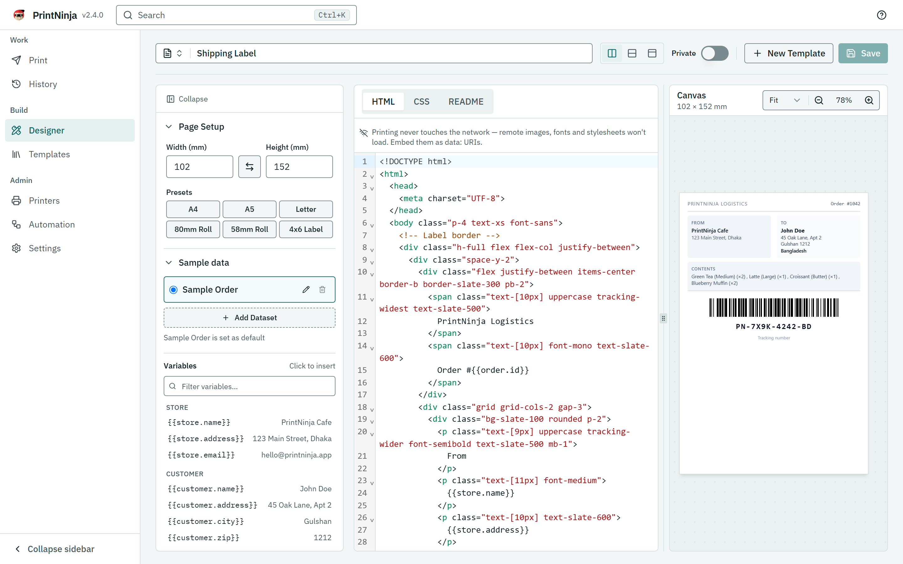
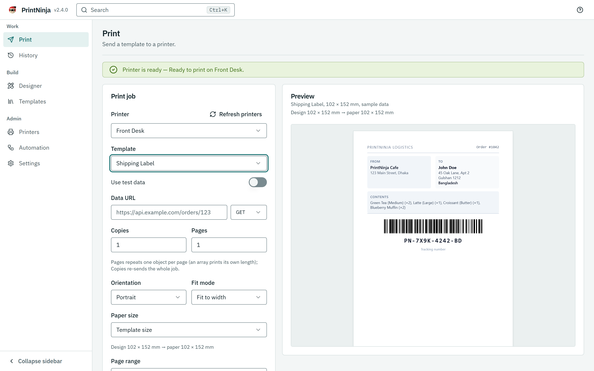
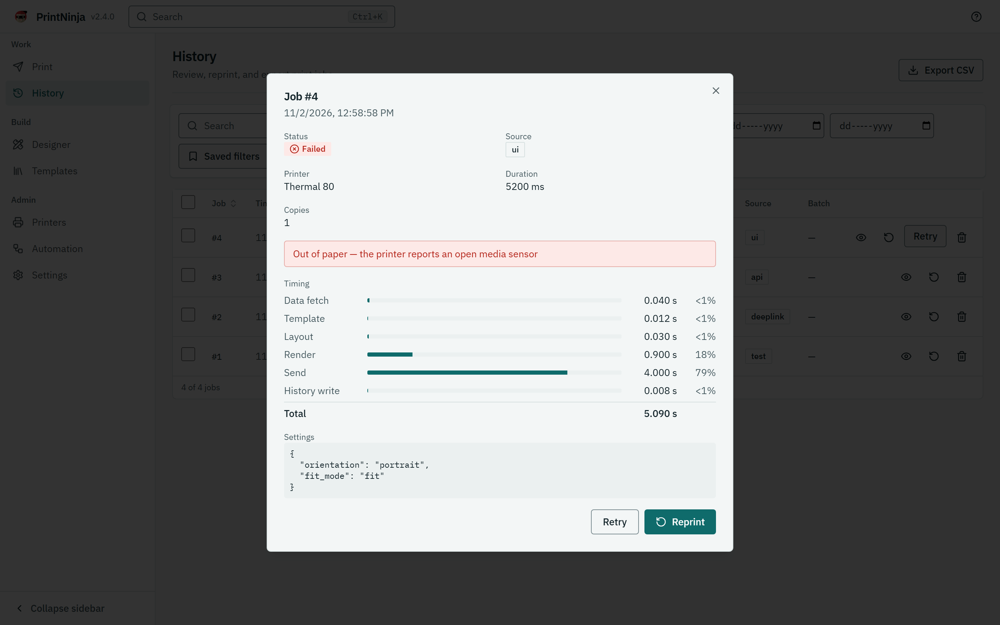

<div align="center">


# PrintNinja

**Silent printing for Windows, Android and Linux.**
Design a receipt or label in HTML and CSS, feed it JSON, and it prints. No print dialog, no driver dance, no fuss.

[](https://github.com/SAR-dev/PrintNinja/releases)


[Install](#install) ·
[First print](#your-first-print) ·
[Print from your phone](#print-from-your-phone) ·
[Automate it](#automate-it) ·
[Troubleshooting](#troubleshooting) ·
[For developers](#for-developers)

</div>

---

## Why PrintNinja?

Printing from software is still a mess of dialogs, drivers and printer-specific quirks. PrintNinja turns it into three steps:

1. **Design** a template with the web skills you already have: HTML, CSS, Tailwind and Handlebars.
2. **Send data** from a JSON URL, a CSV, the REST API or a deep link.
3. **Print silently** to a receipt, label or office printer, with the real reason when something goes wrong.

```handlebars
<h1 class="text-xl font-bold">Order {{order.id}}</h1>
<p>{{date order.createdAt}}</p>
<p class="text-right">{{currency order.total}}</p>

{{barcode "code128" order.id}}
{{qrcode order.url}}
```

The barcode and QR code in the preview are the same ones that come out of the printer.

**Good to know**

- Printing works fully offline. Only live data URLs, template sync and update checks need a connection.
- The app is available in English and Japanese.
- Phones can borrow a nearby PC to render, or even to print. See [Print from your phone](#print-from-your-phone).

## Install

Download the installer for your system from the [Releases page](https://github.com/SAR-dev/PrintNinja/releases):

| System | Installer | Before you start |
|---|---|---|
| **Windows** | `.msi` | Nothing extra. Printing uses the Edge engine that ships with Windows. |
| **Linux** | `.deb` or AppImage | Needs CUPS and a Chromium-family browser. The `.deb` pulls both in; the AppImage does not, so run `apt install chromium` (or install Chrome) first. |
| **Android** | `.apk` | Android lets you install it after you allow installs from your browser. |

Windows and Linux release builds are currently unsigned (see [`docs/SIGNING.md`](docs/SIGNING.md)), so Windows may ask you to confirm before it runs the installer. macOS is not a print target.

## Your first print

About five minutes, start to finish. The **Setup checklist** in Settings walks through the same steps inside the app.

1. **Add a printer.** Open **Printers** and choose **Add printer**. Network printers (IPP or raw TCP 9100), system printers, USB and Bluetooth are all supported. Run a test print to check the connection.
2. **Make a template.** Open **Designer**, create a template, pick a page size (A4, 80 mm or 58 mm roll, 4×6 label, or custom) and write your layout. The canvas updates live.
3. **Print.** Open **Print**, choose the printer and template, add your data (test data, a JSON URL, or a CSV), set copies, check the preview and print.
4. **Check the result.** **History** shows every job with a clear success or failure message. Reprint or retry from there.

| Design a template with a live canvas | …then print it |
|:---:|:---:|
|  |  |

**No printer on your desk?** Start the bundled fake IPP printer and watch jobs land as PDFs:




```bash
pnpm dev:printer  # ipp://localhost:6310/ipp/print
```

Add it in PrintNinja as a network printer at `localhost:6310`. Every job is saved to `dev-printer/output/`. See [`dev-printer/README.md`](dev-printer/README.md).

## Design a template

A template is HTML with `{{placeholders}}` for your data, plus a page size. This complete example prints a small parcel tag on 80 mm roll paper:

```html
<body class="p-2 text-xs font-sans">
  <p class="uppercase tracking-widest text-slate-500">PrintNinja Post</p>
  <h1 class="text-lg font-bold">To: {{customer.name}}</h1>
  <p>{{customer.address}}, {{customer.city}} {{customer.zip}}</p>
  {{barcode "code128" order.tracking width=60 text=false}}
  <p class="font-mono">{{order.tracking}}</p>
</body>
```

With this JSON as the data:

```json
{
  "customer": { "name": "John Doe", "address": "45 Oak Lane, Apt 2", "city": "Gulshan", "zip": "1212" },
  "order": { "tracking": "PN-7X9K-4242-BD" }
}
```

Three things to know:

- **`{{dotted.paths}}` print text.** Nested keys walk the JSON (`{{customer.name}}`), and `{{#each order.items}}…{{/each}}` repeats a block once per list entry.
- **`{{barcode}}` draws the barcode.** `{{barcode "code128" order.tracking}}` renders an inline SVG from the data, so no image files are needed. QR codes work the same way with `"qrcode"`.
- **The page size is the paper.** Set 80 mm wide in Page Setup for roll paper (or 102 × 152 mm for a 4×6 label); the canvas previews exactly that. Utility classes such as `p-2` and `font-bold` are compiled into the printout, and anything the network cannot reach at print time (remote images, web fonts) will not load — embed them as `data:` URIs instead.

Every new template starts from a **starter pack** — Receipt, Delivery Slip, Invoice, Shipping Label, Kitchen Ticket or Blank — chosen in the two-step New Template dialog (pick a pack, then name your copy). The pack is a worked example built from these same pieces, so there is always something concrete to edit down. Publish it from the Designer when you want it listed for the community in **Templates**.

## Print from your phone

Phones are small and Android cannot make every printer language — ESC/POS, ZPL and TSPL print on the phone itself, while CPCL and raster still need a PC. So PrintNinja lets a phone borrow a PC on the same Wi-Fi.

**Pair a phone with a PC**

1. On the PC, open **Automation → Phones** and turn sharing on. One switch does everything, including starting the local server.
2. The PC shows an 8-character code. It expires after about 90 seconds; ask for a new one if it runs out.
3. On the phone, open **Automation → PC** (the same tab, named for what you pair with) and type the code. The phone finds the PC on its own (an mDNS scan of the LAN, shown as **Nearby PCs**), or you can type the PC's address.
4. Both devices must be signed in to the same account on the same server.

**Let someone borrow your PC without an account.** On the PC, choose **Invite guest** and pick how long the invite lasts (24 hours by default), how many times it can be used, and whether the guest may print or only render. The guest enters a name, taps **Continue as guest** on the sign-in screen and types the code. Guests can use templates by name, but can never read or change them.

An unpaired phone can browse the app and print straight to thermal printers (ESC/POS, ZPL, TSPL) — no pair needed. A pair is only for PDF on the phone and Print via PC: choosing a PDF printer on the Print page offers the pairing screen, which greets you by name and returns afterwards.

**Two ways to use a paired PC**

- **Shared rendering.** The PC prepares the PDF and the phone sends it to its own printer. If the PC is off or away, the job fails at once and names the PC. Nothing is silently queued. Retry from History when the PC is back.
- **Print via PC (Android).** The job runs on the PC's printers with the PC's templates, so the template picker lists the PC's templates while this is on. If the phone's copy is out of date, you get a **Sync** prompt instead of a wrong print. There is no silent fallback to local printing; turn the option off to print locally.

**Stay in control.** The PC lists every paired phone. You can rename a phone, switch printing off for it, or remove it, and the change applies from its next request. Turning sharing off disconnects all phones. Everything stays on your local network.

**Android keeps printing in the background.** A background service runs by default, so the print queue keeps draining after you swipe the app away. Use **Open** or **Close** on its notification, and allow the app to ignore battery optimizations in Settings so Android does not delay your prints.

## Automate it

PrintNinja runs a local REST API, so any script, POS or back office on the same PC can print through it. The default address is `127.0.0.1:17717`; you can change the port in **Automation → API server**.

```bash
curl -X POST http://127.0.0.1:17717/v1/print \
  -H "Content-Type: application/json" \
  -H "Idempotency-Key: order-1042" \
  -d '{
        "template": "Receipt",
        "printer": "Front Desk",
        "data": { "order": { "id": "1042", "total": 18.5 } },
        "settings": { "copies": 2 }
      }'
```

- **No API keys.** Calls from the PC itself (scripts, your POS software) work as they are. Other devices on the network must be paired with the PC, and they present their own device token.
- **Safe retries.** Replaying an `Idempotency-Key` never prints a second copy.
- **Honest answers.** The response reports the real outcome (printed, or why not), and `GET /v1/jobs/{id}` tracks any job. Jobs can also be retried or cancelled.
- **Callbacks.** Add `"callback_url": "https://…"` to a print request and the app POSTs the outcome (`print.succeeded` / `print.failed`) to it after the job finishes, retrying a few times on failure. Only `https` URLs are accepted (private hosts unless you opt in), and with a shared secret set the body is signed with an `X-PrintNinja-Signature` HMAC. See `docs/ENV.md` for the `PRINTNINJA_CALLBACK_*` switches.
- **Observable.** Health, metrics in JSON and Prometheus format, and a live OpenAPI document at `/v1/openapi.json`.
- **Try it in the app.** **Automation → Try the API** lets you send requests against the live spec (desktop app only).

**Deep links** print from a link or a button on a web page:

```
printninja://print?template=My+Receipt&printer=Desk&copies=2
```

Other options include `url` (a data URL), `test=1`, `orientation`, `fit` and `preset`. Links from sources you have not trusted ask for confirmation first. Manage trusted sources in **Automation → Deep links**.

## Features

**Designer**
- HTML and CSS editor with a live canvas, fit-to-width and manual zoom
- Page presets for A4, 80 mm and 58 mm rolls, 4×6 labels and custom sizes
- Handlebars templates with helpers such as `currency`, `date`, `upper`, `lower`, `number` and `padLeft`
- Any Tailwind class works; each template is compiled with its own CSS
- Barcodes and QR codes from data (Code 128/39/93, EAN-13/8, UPC-A, ITF, Codabar, QR), identical in preview and print
- Custom fonts, version history with diff and restore, and a README tab per template
- Template names must be unique, and each template shows its Sync ID

**Print**
- Pick a printer, template, data source and copies, preview, then print
- Data from test data or a JSON URL (GET or POST); a JSON array prints one record per label or page
- Per-printer profiles, plus orientation, fit, margins, page range and grayscale under Advanced options
- Clear messages when a printer is out of paper, jammed or offline

**Printers**
- Network (IPP, raw TCP 9100) and system printers on Windows and Linux
- LAN scan finds IPP and raw printers on the network over mDNS; a discovered printer is added in one tap
- On Android, the Add dialog also lists your paired Bluetooth printers (bonded devices) with the same one-tap Fill and Add
- USB and Bluetooth through the Windows spooler, or directly on Android
- Printer languages: PDF, ESC/POS, ZPL, TSPL, CPCL and raster (Android prints ESC/POS, ZPL and TSPL on the device itself; CPCL and raster need a paired PC)
- Status checks before a raw job is sent, and timeouts so a stuck printer never hangs a job

**Templates and sharing**
- Mine, Saved and Community tabs with search and sort; publish, unpublish and save to the server
- Saved community templates sync to every PC on their own, and Clone turns one into your own timestamped, editable copy
- Offline-first: printing keeps working when the server is unreachable, and changes sync when it returns
- A hosted share service with accounts, delta sync, sample datasets, printer profiles, fonts and preferences

**History**
- Filter by status, source, printer, template and date, with saved filter sets
- Bulk reprint and retry, CSV export, and automatic retention (by age and record count)
- Every job shows a timing breakdown: fetch, template, layout, render, send, history
- Jobs from phones show who sent them, and jobs sent through a PC show which PC printed them

**The app itself**
- Tray icon, autostart, single instance, and a background service on Android
- Press `Ctrl/Cmd+K` to find any page, template, printer, job or setting, then jump straight to it
- Status badges in the top bar for every switch that changes behavior (see below)
- Keyboard first: `G` then `P/H/D/T/R/A/S` for navigation
- Phone-friendly layouts with bottom navigation, card lists and a sticky Print bar
- Comfortable or compact density, custom name and logo, IBM Plex fonts bundled for offline use
- Accessibility target: WCAG 2.1 AA

### What the top-bar badges mean

Each badge links to the place where you can turn that switch off.

| Badge | Meaning |
|---|---|
| **API** | The local API server is running on this PC only. |
| **LAN** | The API is reachable from your network. Turn this off if you do not need it. |
| **Sharing** | This PC is live as a renderer for phones. |
| **Via PC** | This phone prints through a paired PC. |
| **Private network open** | Blocking of private IP addresses is off, so data URLs may reach devices on your network. |

## Troubleshooting

**My phone cannot find the PC.** Check that both are on the same Wi-Fi, that sharing is on, and that the code has not expired (ask for a new one). Owners must be signed in to the same account; a signed-out side or a different account is refused before the code is used. You can also type the PC's address by hand. Only private network addresses are accepted.

**A phone job says the PC did not answer.** Make sure the PC is on, awake and on the same Wi-Fi, then refresh. Retry the job from History when it is back.

**It says the template is missing or out of date.** Print via PC compares template versions on purpose. Tap **Sync** on the phone, or sync the template on the PC.

**Printing from Linux fails.** Install CUPS and Chromium or Chrome. For USB and Bluetooth thermal printers, use a CUPS raw queue; PrintNinja cannot talk to them directly on Linux.

**Printing on Windows fails and says Edge produced no PDF.** The first thing to check is whether PrintNinja runs as administrator — headless Edge will not print from an elevated process, the app says so, and restarting it without "Run as administrator" fixes it. Otherwise, a running Edge session can take headless print launches for itself (exit code 0, no PDF). Run **Fix PC printing** in Settings → Diagnostics: it closes Edge (verifying that it is really gone), clears stale render profiles and runs a test render. If Edge keeps respawning, use the headless browser the repair offers to download (~150 MB, SHA-256 verified, no installer) — it prints while your Edge windows stay open. Advanced: point `PRINTNINJA_EDGE_BIN` at a browser of your choice (see `docs/ENV.md`).

**A USB or Bluetooth receipt or label printer prints pages of random characters.** The printer's language is set to PDF, so the raw PDF file is being sent to a head that only understands a command language. Open **Printers**, edit the printer and set **Language** to the one it speaks (ESC/POS for most receipt printers; ZPL, TSPL or CPCL for label printers). If it was already ESC/POS, check that the printer itself is in that mode; many label printers ship in a different one.

**My USB or Bluetooth printer is not listed on Windows.** Install it as a Windows printer first. PrintNinja uses the Windows spooler for both.

**Android stops printing after I close the app.** Open Settings and check that the background service is running and that battery optimizations are ignored for PrintNinja.

**A data URL is blocked.** Go to **Settings → Data & network**. You can allow the domain there. Private-IP blocking is also on that page.

**I cannot print from the web preview.** The browser version only previews. Printing needs the desktop or Android app.

If you are stuck, export logs from **Settings → Diagnostics** and attach them to your report.

## Documentation

- [`docs/ARCHITECTURE.md`](docs/ARCHITECTURE.md): the big picture — system map, pipeline, phone↔PC, and where a print can fail
- [`docs/GLOSSARY.md`](docs/GLOSSARY.md): the plain meaning of every term the app uses
- [`docs/architecture/RENDERING_AND_LAYOUT.md`](docs/architecture/RENDERING_AND_LAYOUT.md): how a design becomes pages and sheets
- [`docs/architecture/PRINTERS_AND_TRANSPORTS.md`](docs/architecture/PRINTERS_AND_TRANSPORTS.md): transports, printer languages, per-OS notes
- [`docs/MISSING_FEATURES.md`](docs/MISSING_FEATURES.md): printer support gaps by platform and connection type, with priorities and workarounds
- [`docs/architecture/QUEUE_AND_HISTORY.md`](docs/architecture/QUEUE_AND_HISTORY.md): the queue, timings, metrics and callbacks
- [`docs/architecture/PHONE_AND_PC_SHARING.md`](docs/architecture/PHONE_AND_PC_SHARING.md): pairing, tokens, guests and Print via PC, plus the recorded "why" behind the rules
- [`docs/DEVELOPMENT.md`](docs/DEVELOPMENT.md): developer quick start, project layout, commands, release
- [`docs/UI_GUIDE.md`](docs/UI_GUIDE.md): design principles, components and status vocabulary
- [`docs/ENV.md`](docs/ENV.md): share service environment variables
- [`docs/CI.md`](docs/CI.md): local checks, hosted workflow and scheduled jobs
- [`docs/RELEASE.md`](docs/RELEASE.md) and [`docs/SIGNING.md`](docs/SIGNING.md): releasing and signing

## For developers

Everything a developer needs — quick start, project layout, tech stack, commands, running the share service, and how releases ship — lives in [`docs/DEVELOPMENT.md`](docs/DEVELOPMENT.md). The architecture of the print pipeline is in [`docs/ARCHITECTURE.md`](docs/ARCHITECTURE.md) and the `docs/architecture/` deep dives.

### Contributing

Pull requests go to `develop`; `main` is the release branch. Keep commits small, use conventional messages (`feat(print): …`, `fix(designer): …`), and add a regression test with every bug fix. The full rules are in [`CONTRIBUTING.md`](CONTRIBUTING.md).

## License

Proprietary. All rights reserved.
