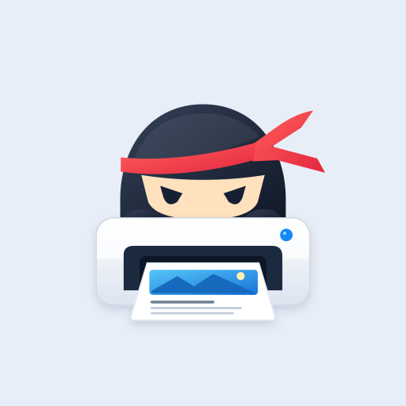
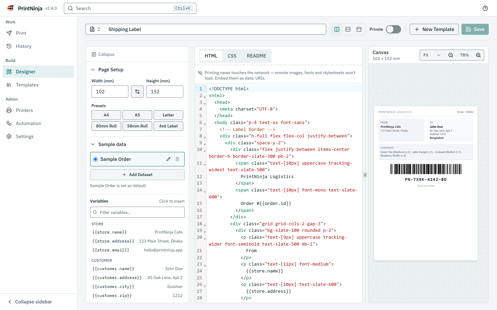
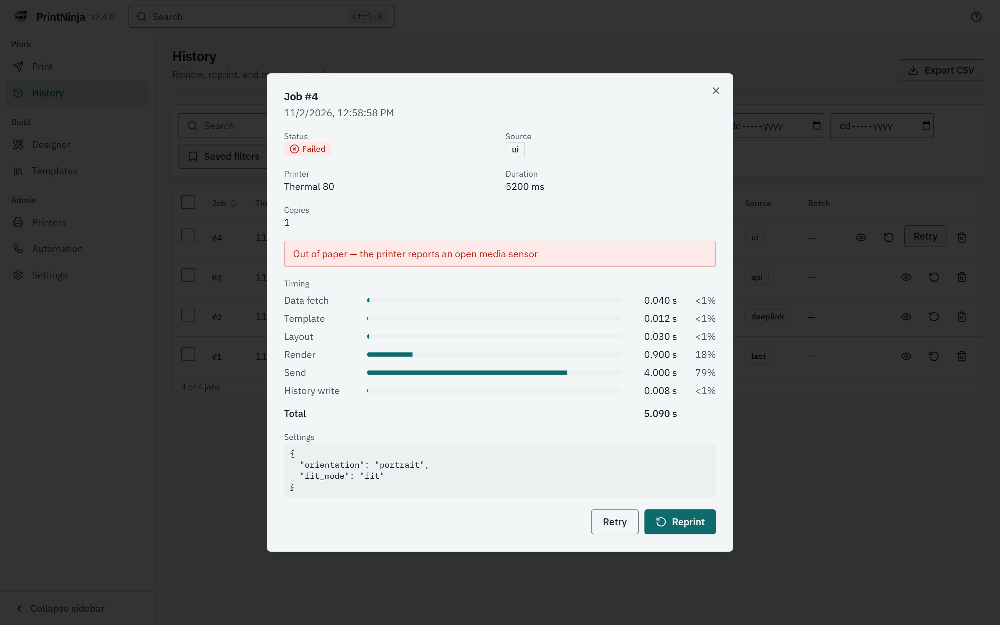

<div align="center">



# PrintNinja

**🖨️ Print receipts, labels and documents with one click. No print dialogs, no driver headaches.**

Works on Windows 🪟, Android 🤖 and Linux 🐧. Pair a Bluetooth printer and go, or use any printer you already have.

[](https://github.com/SAR-dev/PrintNinja/releases)


[🥷 What is it?](#what-is-printninja) ·
[📦 Install](#install) ·
[🚀 Your first print](#your-first-print) ·
[📱 Print from your phone](#print-from-your-phone) ·
[🛠️ Troubleshooting](#troubleshooting) ·
[⚡ Power users](#for-power-users) ·
[👩‍💻 Developers](#for-developers)

</div>

---

<a id="what-is-printninja"></a>

## 🥷 What is PrintNinja?

PrintNinja is an app that prints for you, quietly, without the usual fuss. You pick a printer, pick a layout, and press **Print**. The paper comes out. That is the whole idea. 🎉

It is built for people who print the same kinds of things again and again:

- ☕ **Shops and cafés** printing receipts and kitchen tickets
- 📦 **Delivery and warehouse teams** printing shipping and parcel labels
- 🏢 **Offices** printing invoices and delivery slips
- 📲 **Anyone** who wants printing from a phone, tablet or PC to just work

**✨ What you get**

- 🚫 **No pop-up print windows.** Jobs go straight to the printer.
- 💬 **A clear answer every time.** If a print fails, PrintNinja tells you why (out of paper, printer offline, and so on) instead of failing silently.
- 🕘 **A history of every print.** Look back at what was printed, and reprint it with one tap.
- 📴 **Works without internet.** Printing keeps working offline. You only need a connection for live data links, template sharing and update checks.
- 👀 **Preview that matches the paper.** What you see on screen is what comes out of the printer, including barcodes and QR codes.
- 🌏 **English and Japanese.** The app is available in both languages.

<a id="install"></a>

## 📦 Install

Download the installer for your device from the [Releases page](https://github.com/SAR-dev/PrintNinja/releases), then open it.

| Your device | Download this | Good to know |
|---|---|---|
| 🪟 **Windows** | the `.msi` file | Nothing else to install. |
| 🤖 **Android** | the `.apk` file | Android will ask you to allow installs from your browser. Say yes, then open the file. |
| 🐧 **Linux** | the `.deb` file (or the AppImage) | The `.deb` installs everything it needs. The AppImage does not, so install CUPS and Chromium (or Chrome) first, for example with `sudo apt install cups chromium`. |

**⚠️ Seeing a warning on Windows?** The Windows and Linux downloads are not digitally signed yet, so Windows may show a "Windows protected your PC" message. Choose **More info**, then **Run anyway**. (Why this happens: [`docs/SIGNING.md`](docs/SIGNING.md).)

Mac computers are not supported for printing. 🍎

<a id="your-first-print"></a>

## 🚀 Your first print

This takes about five minutes. ⏱️ The **Setup checklist** in **Settings** walks you through the same steps inside the app.

1. 🖨️ **Add a printer.** Open **Printers**, then choose **Add printer**. Wi-Fi/network printers, printers already installed on your computer, USB printers and Bluetooth printers all work. Press **Test Print** to make sure it is connected.
2. 🎨 **Make a template.** A template is the layout of what you want to print, like a receipt or a label. Open **Designer**, create a template, pick a paper size (A4, 80 mm or 58 mm receipt roll, 4×6 label, or your own size) and design it. The preview updates as you type. Every new template starts from a ready-made example (Receipt, Delivery Slip, Invoice, Shipping Label, Kitchen Ticket or Blank), so you can edit instead of starting from nothing.
3. ▶️ **Print.** Open **Print**, choose your printer and template, add your information (sample data, a link to your data, or a CSV spreadsheet file), choose how many copies, check the preview and press **Print**.
4. ✅ **Check the result.** **History** lists every job with a clear success or failure message. Reprint or retry from there.

| Design a template with a live preview | ...then print it |
|:---:|:---:|
|  |  |



### 🔌 Which kind of printer do I have?

| If your printer is... | Connect it like this |
|---|---|
| 🏠 A normal office or home printer already set up on your computer | Add it as a **system** printer. It shows up in the list automatically. |
| 📶 On your Wi-Fi or office network | Use the network scan in **Add printer**. Found printers are added with one tap. |
| 🔵 A small **Bluetooth** receipt or label printer | Pair it in your device's Bluetooth settings first, then add it in PrintNinja as **Bluetooth**. No driver is needed. |
| 🔌 A **USB** receipt or label printer | Install it on your computer first (see [Troubleshooting](#troubleshooting)), then add it as a **system** printer. On Android, USB works directly. |

Receipt and label printers often "speak" their own language instead of reading normal documents. If one prints pages of strange characters, change its **Language** setting in **Printers**. See [Troubleshooting](#troubleshooting).

<a id="print-from-your-phone"></a>

## 📱 Print from your phone

You can print straight from an Android phone to a Bluetooth or USB receipt or label printer, with nothing else needed.

For printing normal documents (PDF) from the phone, or for using your PC's printers, you can **pair** your phone with a PC on the same Wi-Fi. Everything stays on your local network.

**🤝 Pair a phone with a PC**

1. On the PC, open **Devices** and switch sharing on. This one switch does everything for you.
2. The PC shows an 8-character code. It runs out after about 90 seconds; ask for a new one if it does.
3. On the phone, open **Connect to PC** and type the code. The phone usually finds the PC by itself under **Nearby PCs**. If not, type the PC's address.
4. Both devices must be signed in to the same account on the same server.

**🎟️ Let someone borrow your PC without an account.** On the PC, choose **Invite guest**. You decide how long the invite lasts (24 hours by default), how many times it can be used, and whether the guest may print or only prepare pages. The guest enters a name, taps **Continue as guest** and types the code. Guests can use your templates but can never read or change them.

**🔀 Two ways to use a paired PC**

- **Shared rendering.** The PC prepares the page and the phone prints it on its own printer. If the PC is off or away, the job fails right away and tells you which PC did not answer. Nothing is silently left waiting. Retry from **History** when the PC is back.
- **Print via PC (Android).** The whole job runs on the PC's printers using the PC's templates. If the phone's copy of a template is out of date, you are asked to **Sync** instead of getting a wrong print. There is no hidden fallback to the phone's printers; switch the option off to print on the phone again.

**🔒 You stay in control.** The PC lists every paired phone. You can rename a phone, turn printing off for it, or remove it. Turning sharing off disconnects all phones.

**🔋 Keep printing after you close the app (Android).** A background service keeps the print queue going even after you swipe the app away. Allow PrintNinja to ignore battery optimization in your Android settings so your prints are not delayed.

<a id="troubleshooting"></a>

## 🛠️ Troubleshooting

Find the problem that sounds like yours. If you are still stuck, see [Getting help](#getting-help). 💪

### 🖨️ Printers

**🔤 A receipt or label printer prints pages of random characters.**
The printer is being sent a normal document, but it only understands its own command language. Open **Printers**, edit the printer and change **Language** to the one it speaks: **ESC/POS** for most receipt printers, or **ZPL**, **TSPL** or **CPCL** for label printers. If it was already ESC/POS, check the printer's own mode; many label printers ship set to a different one.

**🔌 My USB printer is not in the list.**
- **Windows:** install the printer in Windows first (**Printers & scanners**, then **Add device**). It then appears in PrintNinja under **System**. If it speaks a command language, set **Language** after adding it.
- **Linux:** install CUPS and the printer's driver. For a USB thermal or label printer, create a **raw** CUPS queue, for example `lpadmin -p MyPrinter -m raw -v usb://...`, so the printer receives its commands untouched. It then appears under **System**.
- **Android:** USB printers connect directly; nothing to install.

**🔵 How do I add a Bluetooth printer?**
Pair it in your device's Bluetooth settings, then add it in PrintNinja as **Bluetooth** with the printer's address (its MAC address). On Android, paired printers are listed for you. No driver is needed. On Windows you can also use the COM port Windows gives the printer.

**🧩 I want to use my printer's own driver instead.**
In **Printers**, edit the printer and turn on **Print through the OS driver**. The printer must already be installed on your computer under the same name. PrintNinja then does exactly that and never switches between methods on its own.

### 💻 Problems on a computer

**🐧 Printing on Linux fails.**
Install CUPS and Chromium or Chrome. Bluetooth printers need neither; pair them in your Bluetooth settings and add them with their address.

**🪟 Printing on Windows fails with "Edge produced no PDF".**
1. If PrintNinja is running **as administrator**, close it and start it again normally. Edge will not print for an administrator process, and the app tells you so.
2. Otherwise open **Settings → Diagnostics** and run **Fix PC printing**. It closes Edge, cleans up leftovers and runs a test.
3. If Edge keeps coming back, the repair offers to download a small separate browser just for printing (about 150 MB, verified, no installer). Your own Edge windows can stay open.

**🚧 A data link is blocked.**
Go to **Settings → Data & network**. You can allow the website there. Blocking of private network addresses is on the same page.

**🌐 I cannot print from the web preview.**
The browser version is a preview only. Printing needs the desktop or Android app.

### 📱 Phones

**🔍 My phone cannot find the PC.**
Check that both are on the same Wi-Fi, that sharing is switched on, and that the code has not run out. Both must be signed in to the same account. You can also type the PC's address by hand (only addresses inside your own network are accepted).

**😴 A phone job says the PC did not answer.**
Make sure the PC is on, awake and on the same Wi-Fi, then refresh. Retry the job from **History**.

**🔄 It says the template is missing or out of date.**
This is on purpose, so you never get a print from an old version. Tap **Sync** on the phone, or sync the template on the PC.

**🤖 Android stops printing after I close the app.**
Open **Settings** in PrintNinja and check that the background service is running. Also check that battery optimization is switched off for PrintNinja in Android's own settings.

<a id="getting-help"></a>

## 🙋 Getting help

- 🐞 **Something broke or looks wrong?** Open **Settings → Diagnostics** and choose **Export Diagnostics**, then attach the file when you [report it](https://github.com/SAR-dev/PrintNinja/issues). Say what you did, what you expected, and what happened.
- 💡 **Want to suggest an idea?** Same place. We would love to hear it.
- 📖 **Not sure what a word means?** See the [glossary](docs/GLOSSARY.md), which explains every term in plain language.

💙 Want to help improve PrintNinja, even without writing code? See [CONTRIBUTING.md](CONTRIBUTING.md).

## 🏷️ What the badges at the top of the app mean

Some small badges appear in the app's top bar. Each one links to the place where you can turn that feature off.

| Badge | Meaning |
|---|---|
| **API** | The local API (see below) is running on this PC only. |
| **LAN** | Other devices on your network can reach the API. Turn this off if you do not need it. |
| **Sharing** | This PC is available to help phones print. |
| **Via PC** | This phone is printing through a paired PC. |
| **Private network open** | Blocking of private network addresses is off, so data links may reach devices on your network. |

## ✨ Everything it can do

**🎨 Design**
- HTML and CSS editor with a live preview, zoom and fit-to-width
- Ready-made paper sizes: A4, 80 mm and 58 mm rolls, 4×6 labels, and custom sizes
- Barcodes and QR codes made from your data (Code 128/39/93, EAN-13/8, UPC-A, ITF, Codabar, QR), identical in preview and on paper
- Custom fonts, version history with compare and restore, and a notes tab for each template

**🖨️ Print**
- Choose a printer, template, data and number of copies, preview, then print
- Data from sample data, a web link (JSON) or a CSV file; a list of records prints one label or page per record
- Extra options: orientation, fit, margins, page range and black-and-white
- Clear messages when a printer is out of paper, jammed or offline

**🔌 Printers**
- Network, system, USB and Bluetooth printers on Windows, Linux and Android
- Automatic network scan that finds printers and adds them in one tap
- Works with document printers (PDF) and receipt/label languages: ESC/POS, ZPL, TSPL, CPCL and raster
- Checks the printer before sending a job, with time limits so a stuck printer never freezes your queue

**🤝 Templates and sharing**
- **Mine**, **Saved** and **Community** tabs with search and sorting
- Publish a template for others, or save community templates and copy them into your own editable version
- Works offline first; changes sync when the connection returns

**🕘 History**
- Filter by status, source, printer, template and date
- Reprint or retry many jobs at once, export to CSV, and automatic cleanup of old records
- See how long each step of a job took, and who or what sent it

**🧰 The app itself**
- Tray icon, start with your computer, and a background service on Android
- Press `Ctrl/Cmd+K` to search for any page, template, printer, job or setting
- Keyboard shortcuts: press `G`, then `P`, `H`, `D`, `T`, `R`, `A` or `S` to jump between pages
- Phone-friendly layouts, comfortable or compact spacing, your own name and logo
- Built to meet accessibility standard WCAG 2.1 AA

---

<a id="for-power-users"></a>

## ⚡ For power users

Everything below is optional. You do not need any of it to print.

### 🎨 Design a template

A template is HTML with `{{placeholders}}` where your data goes, plus a paper size. This complete example prints a small parcel tag on 80 mm roll paper:

```html
<body class="p-2 text-xs font-sans">
  <p class="uppercase tracking-widest text-slate-500">PrintNinja Post</p>
  <h1 class="text-lg font-bold">To: {{customer.name}}</h1>
  <p>{{customer.address}}, {{customer.city}} {{customer.zip}}</p>
  {{barcode "code128" order.tracking width=60 text=false}}
  <p class="font-mono">{{order.tracking}}</p>
</body>
```

With this data (JSON):

```json
{
  "customer": { "name": "John Doe", "address": "45 Oak Lane, Apt 2", "city": "Gulshan", "zip": "1212" },
  "order": { "tracking": "PN-7X9K-4242-BD" }
}
```

Three things to know:

- **`{{dotted.paths}}` print text.** Nested keys walk the data (`{{customer.name}}`), and `{{#each order.items}}...{{/each}}` repeats a block once per list entry. Helpers such as `currency`, `date`, `upper`, `lower`, `number` and `padLeft` are available.
- **`{{barcode}}` draws the barcode.** `{{barcode "code128" order.tracking}}` makes an inline image from the data, so no image files are needed. QR codes work the same way with `"qrcode"`.
- **The page size is the paper.** Set 80 mm wide in Page Setup for roll paper (or 102 × 152 mm for a 4×6 label); the preview shows exactly that. Tailwind classes such as `p-2` and `font-bold` work and are built into the printout. Anything the network cannot reach at print time (remote images, web fonts) will not load, so embed them as `data:` links instead.

### 🤖 Automate printing

PrintNinja runs a local REST API, so any script, till or back-office system on the same PC can print through it. The default address is `127.0.0.1:17717`; change the port in **Automation → API server**.

```bash
curl -X POST http://127.0.0.1:17717/v1/print \
  -H "Content-Type: application/json" \
  -H "Idempotency-Key: order-1042" \
  -d '{
        "template": "Receipt",
        "printer": "Front Desk",
        "data": { "order": { "id": "1042", "total": 18.5 } },
        "settings": { "copies": 2 }
      }'
```

- **No API keys.** Calls from the PC itself work as they are. Other devices on the network must be paired with the PC and present their own device token.
- **Safe retries.** Sending the same `Idempotency-Key` again never prints a second copy.
- **Honest answers.** The response reports the real outcome (printed, or why not). `GET /v1/jobs/{id}` tracks any job, and jobs can be retried or cancelled.
- **Callbacks.** Add `"callback_url": "https://..."` to a print request and the app posts the result (`print.succeeded` or `print.failed`) to it when the job finishes, retrying a few times on failure. Only `https` addresses are accepted (private hosts only if you opt in). With a shared secret set, the message is signed with an `X-PrintNinja-Signature` header. See [`docs/ENV.md`](docs/ENV.md) for the `PRINTNINJA_CALLBACK_*` settings.
- **Observable.** Health checks, metrics (JSON and Prometheus) and a live OpenAPI document at `/v1/openapi.json`.
- **Try it in the app.** **Automation → Try the API** lets you send test requests (desktop app only).

**🔗 Deep links** print from a link or a button on a web page:

```
printninja://print?template=My+Receipt&printer=Desk&copies=2
```

Other options include `url` (a data link), `test=1`, `orientation`, `fit` and `preset`. Links from sources you have not trusted ask for confirmation first. Manage trusted sources in **Automation → Deep links**.

---

<a id="for-developers"></a>

## 👩‍💻 For developers

Everything a developer needs (quick start, project layout, tech stack, commands, running the share service, and releases) is in [`docs/DEVELOPMENT.md`](docs/DEVELOPMENT.md). The quickest way to a running copy:

```bash
git clone https://github.com/SAR-dev/PrintNinja.git
cd PrintNinja
pnpm install
pnpm dev          # web preview at http://localhost:1420
pnpm tauri:dev    # the full desktop app
```

You need Node 22, pnpm 10 and Rust 1.90. The full list, including Android requirements, is in [CONTRIBUTING.md](CONTRIBUTING.md#set-up-your-computer-developers).

**🧪 No printer on your desk?** Start the bundled fake printer and watch each job arrive as a PDF:

```bash
pnpm dev:printer  # ipp://localhost:6310/ipp/print
```

Add it in PrintNinja as a network printer at `localhost:6310`. Every job is saved to `dev-printer/output/`. See [`dev-printer/README.md`](dev-printer/README.md).

**Built with:** Tauri 2, Rust, React 18 and TypeScript. The full stack is listed in [`docs/DEVELOPMENT.md`](docs/DEVELOPMENT.md#tech-stack).

### 📚 More documentation

- [`docs/ARCHITECTURE.md`](docs/ARCHITECTURE.md): the big picture: system map, pipeline, phone to PC, and where a print can fail
- [`docs/GLOSSARY.md`](docs/GLOSSARY.md): the plain meaning of every term the app uses
- [`docs/architecture/RENDERING_AND_LAYOUT.md`](docs/architecture/RENDERING_AND_LAYOUT.md): how a design becomes pages and sheets
- [`docs/architecture/PRINTERS_AND_TRANSPORTS.md`](docs/architecture/PRINTERS_AND_TRANSPORTS.md): connection types, printer languages, per-system notes
- [`docs/architecture/QUEUE_AND_HISTORY.md`](docs/architecture/QUEUE_AND_HISTORY.md): the queue, timings, metrics and callbacks
- [`docs/architecture/PHONE_AND_PC_SHARING.md`](docs/architecture/PHONE_AND_PC_SHARING.md): pairing, tokens, guests and Print via PC
- [`docs/MISSING_FEATURES.md`](docs/MISSING_FEATURES.md): printer support gaps by system and connection type, with workarounds
- [`docs/TEST_CHECKLIST.md`](docs/TEST_CHECKLIST.md): real-printer test checklist (not yet run on hardware)
- [`docs/DEVELOPMENT.md`](docs/DEVELOPMENT.md): developer quick start, project layout, commands, release
- [`docs/UI_GUIDE.md`](docs/UI_GUIDE.md): design principles, components and status wording
- [`docs/ENV.md`](docs/ENV.md): share service settings
- [`docs/CI.md`](docs/CI.md): local checks, hosted workflow and scheduled jobs
- [`docs/RELEASE.md`](docs/RELEASE.md) and [`docs/SIGNING.md`](docs/SIGNING.md): releasing and signing

## 📄 License

Proprietary. All rights reserved.
