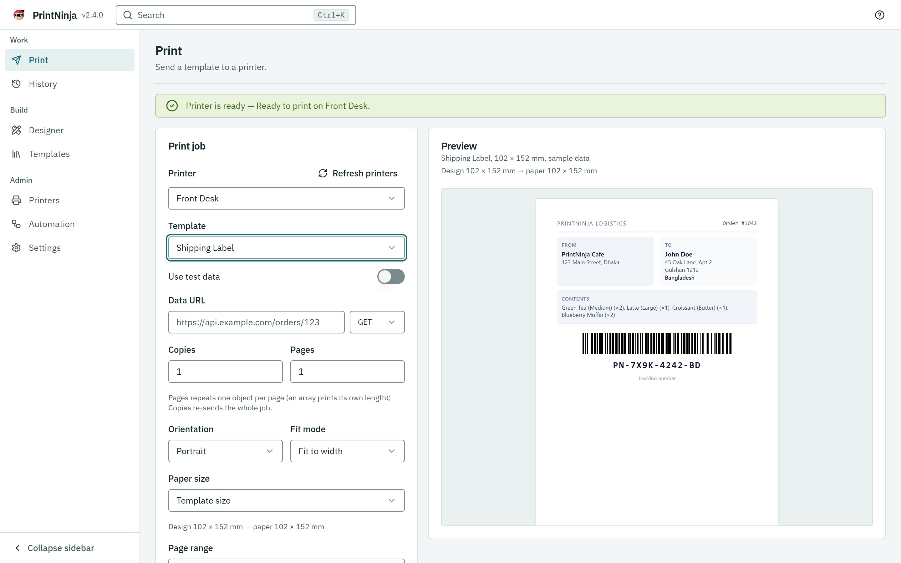

<div align="center">


# PrintNinja

**🖨️ Print receipts, labels and documents with one click. No print dialogs, no driver headaches.**

Works on Windows 🪟, Android 🤖 and Linux 🐧. Pair a Bluetooth printer and go, or use any printer you already have.

[](https://github.com/SAR-dev/PrintNinja/releases)


[📦 Install](#install) ·
[🚀 First print](#your-first-print) ·
[📱 Phone](#print-from-your-phone) ·
[🛠️ Help](#troubleshooting) ·
[📚 Guides](#guides) ·
[👩‍💻 Developers](#for-developers)

</div>

---

## 🥷 What is PrintNinja?

PrintNinja prints for you, quietly, without the usual fuss. You pick a printer, pick a layout, and press **Print**. The paper comes out. 🎉

It is built for people who print the same things again and again:

- ☕ **Shops and cafés** printing receipts and kitchen tickets
- 📦 **Delivery and warehouse teams** printing shipping and parcel labels
- 🏢 **Offices** printing invoices and delivery slips
- 📲 **Anyone** who wants printing from a phone, tablet or PC to just work

### 🏷️ Two kinds of templates

- 🏷️ **Label templates** are for thermal printers — receipts and labels. You design them on a canvas in millimetres: text, barcodes, QR codes, images, lines and frames. No HTML, no CSS.
- 📄 **Document templates** are for regular office and home printers. They are HTML and CSS with `{{placeholders}}` where your data goes.

Both live on the **Templates** page, and each row wears a badge that names its kind. The app sends each one to the right printer and refuses a wrong pairing before a byte is wasted.

**✨ What you get**

- 🚫 **No pop-up print windows.** Jobs go straight to the printer.
- 💬 **A clear answer every time.** If a print fails, you are told why (out of paper, printer offline, and so on).
- 🕘 **A history of every print,** with one-tap reprint.
- 👀 **A preview that matches the paper,** barcodes and QR codes included — label previews go through the real print path at the printer's own DPI.
- 📴 **Works without internet.** You only need a connection for live data links, template sharing and update checks.
- 🌏 **English and Japanese.**

<a id="install"></a>

## 📦 Install

Download the installer for your device from the [Releases page](https://github.com/SAR-dev/PrintNinja/releases), then open it.

| Your device | Download this | Good to know |
|---|---|---|
| **Windows** | the `.msi` file | Nothing else to install. |
| **Android** | the `.apk` file | Android will ask you to allow installs from your browser. Say yes, then open the file. |
| **Linux** | the `.deb` file (or the AppImage) | The `.deb` installs everything it needs. The AppImage does not, so install CUPS and Chromium (or Chrome) first, for example with `sudo apt install cups chromium`. |

**⚠️ Seeing a warning on Windows?** The Windows and Linux downloads are not digitally signed yet, so Windows may show a "Windows protected your PC" message. Choose **More info**, then **Run anyway**. (Why this happens: [`docs/SIGNING.md`](docs/SIGNING.md).)

Mac computers are not supported for printing. 🍎

<a id="your-first-print"></a>

## 🚀 Your first print

This takes about five minutes. ⏱️ The **Setup checklist** in **Settings** walks you through the same steps inside the app.

1. 🖨️ **Add a printer.** Open **Printers**, then choose **Add printer**. Network, system, USB and Bluetooth printers all work. Press **Test Print** to make sure it is connected.
2. 🎨 **Make a template.** Open **Templates**, press **New**, and pick **New label template** (for a thermal printer) or **New document template** (for a regular one). The Designer opens for you: a label template starts as a blank label you arrange on a canvas, and a document template starts from a ready-made example (Receipt, Invoice, Shipping Label, …) that you edit.
3. ▶️ **Print.** Open **Print**, choose your printer and template, add your information (sample data, a link to your data, or a CSV file), choose how many copies, check the preview and press **Print**.
4. ✅ **Check the result.** **History** lists every job with a clear success or failure message. Reprint or retry from there.

| 1. Design a template | 2. Print it | 3. Check the result |
|:---:|:---:|:---:|
|  |  |  |

### 🔌 Which kind of printer do I have?

| If your printer is... | Connect it like this |
|---|---|
| 🏠 A normal office or home printer already set up on your computer | Add it as a **system** printer. It shows up in the list automatically. |
| 📶 On your Wi-Fi or office network | Use the network scan in **Add printer**. Found printers are added with one tap. |
| 🔵 A small **Bluetooth** receipt or label printer | Pair it in your device's Bluetooth settings first, then add it in PrintNinja as **Bluetooth**. No driver is needed. |
| 🔌 A **USB** receipt or label printer | Install it on your computer first, then add it as a **system** printer. On Android, USB works directly. |

<a id="print-from-your-phone"></a>

## 📱 Print from your phone

An Android phone can print straight to a Bluetooth or USB receipt or label printer, with nothing else needed. It works with ESC/POS, ZPL, TSPL, CPCL and raster on the phone itself, and only PDF needs a paired PC. To print normal documents (PDF) from the phone, or to use a PC's printers, **pair** the phone with a PC on the same Wi-Fi. Everything stays on your local network.

👉 Step by step: [Print from your phone](docs/PRINT_FROM_PHONE.md)

<a id="troubleshooting"></a>

## 🛠️ Troubleshooting

| Problem | Try this |
|---|---|
| 🔤 A receipt or label printer prints pages of strange characters | In **Printers**, edit the printer and set **Language** to **ESC/POS** (most receipt printers) or **ZPL**, **TSPL** or **CPCL** (label printers). |
| 📄 A PDF will not print on a receipt or label printer | A thermal head cannot read a PDF. Send the file to a document (office) printer — or design a **label template** for that job. |
| 🔌 My USB printer is not in the list | Install it in Windows or Linux first. It then appears under **System**. |
| 🐧 Printing on Linux fails | Install CUPS and Chromium or Chrome. |
| 🪟 Windows says "Edge produced no PDF" | If PrintNinja runs as administrator, restart it normally. Otherwise run **Settings → Diagnostics → Fix PC printing**. |
| 🔍 My phone cannot find the PC | Check the same Wi-Fi, sharing switched on, an unexpired code and the same account on both. |

👉 More fixes: [Troubleshooting guide](docs/TROUBLESHOOTING.md)

<a id="getting-help"></a>

### 🙋 Getting help

- 🐞 **Something broke?** Open **Settings → Diagnostics**, choose **Export Diagnostics**, and attach the file when you [report it](https://github.com/SAR-dev/PrintNinja/issues). Say what you did, what you expected, and what happened.
- 💡 **Have an idea?** Same place. We would love to hear it.
- 💙 **Want to help, even without writing code?** See [CONTRIBUTING.md](CONTRIBUTING.md).

<a id="guides"></a>

## 📚 Guides

- 🎉 [What's new](docs/CHANGELOG.md): a plain-English list of what changed in each version
- ✨ [Features](docs/FEATURES.md): everything it can do, and what the top-bar badges mean
- 📱 [Print from your phone](docs/PRINT_FROM_PHONE.md): pairing, guests and background printing
- 🛠️ [Troubleshooting](docs/TROUBLESHOOTING.md): fixes for common problems
- ⚡ [Templates and automation](docs/AUTOMATION.md): placeholders, the REST API and deep links
- 📖 [Glossary](docs/GLOSSARY.md): plain meanings for every term the app uses
- 🗂️ [All documentation](docs/README.md)

<a id="for-developers"></a>

## 👩‍💻 For developers

```bash
git clone https://github.com/SAR-dev/PrintNinja.git
cd PrintNinja
pnpm install
pnpm dev          # web preview at http://localhost:1420
pnpm tauri:dev    # the full desktop app
```

You need Node 22, pnpm 10 and Rust 1.90 (full list in [CONTRIBUTING.md](CONTRIBUTING.md#set-up-your-computer-developers)). No printer handy? `pnpm dev:printer` starts a fake one that saves each job as a PDF; see [`dev-printer/README.md`](dev-printer/README.md).

Built with Tauri 2, Rust, React 18 and TypeScript. Project layout, commands and the architecture are in [`docs/DEVELOPMENT.md`](docs/DEVELOPMENT.md) and [`docs/ARCHITECTURE.md`](docs/ARCHITECTURE.md).

## 📄 License

Proprietary. All rights reserved.
