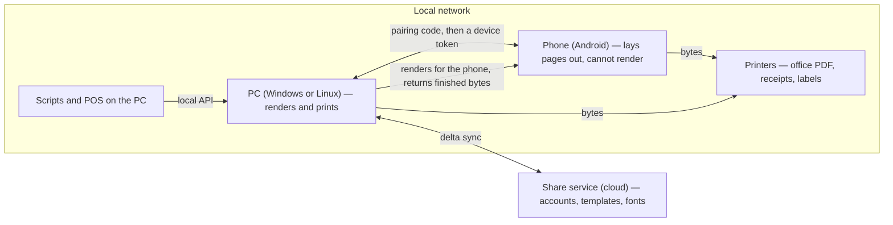
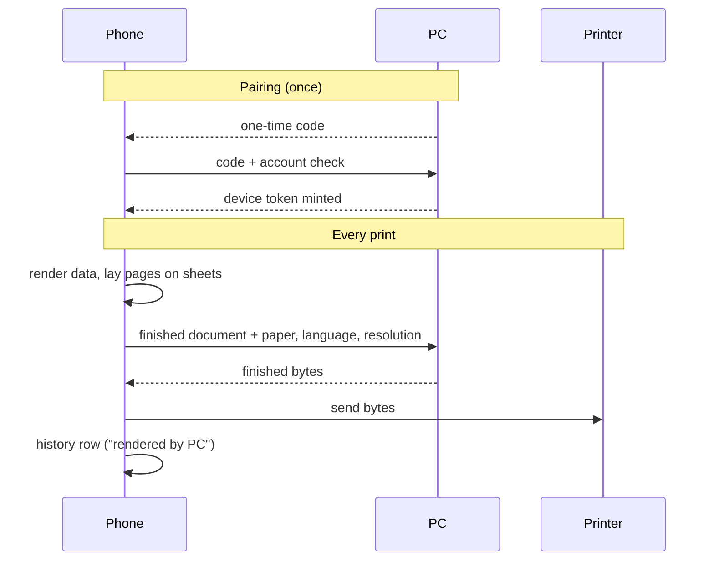
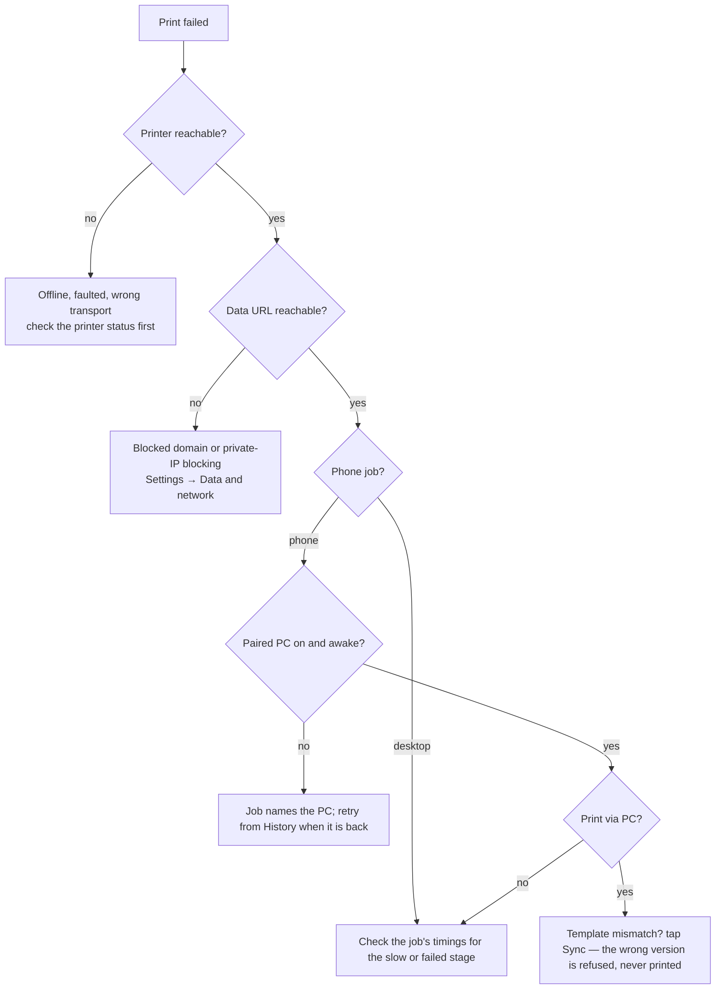

# Print Architecture

> **Who this is for:** anyone new to the project, or anyone who needs the big picture before opening a deep dive.
> **What you will know after reading:** what each part of the system is, how a print flows from data to paper, how a phone and a PC work together, where a print can fail, and which document to read for your question.

This is the overview. It deliberately contains no code, no file paths and no
command-line flags; every detail lives in the deep dives it points to. The
plain words used here are collected in the [glossary](./GLOSSARY.md).

## The system

One machine does the heavy work: a **PC** (Windows or Linux) can render a
design into an image or PDF and can print. A **phone** lays pages out but
cannot render, so it is always paired with a PC that does that one step for
it. The **share service** in the cloud stores accounts, templates and fonts;
it has no rendering engine, so a print never travels through it.

## The pipeline

Raw business data goes in one end, printer-specific bytes come out the other,
and every step exists to answer one question: what should each dot on the
paper be?

The middle is the part to hold in your head. A template renders into
*design pages* exactly as it looks in the Designer, with no knowledge of any
paper. Only afterwards are those finished pages *placed* on physical
*sheets*. Rendering and placement are separate steps, and **nothing about the
paper ever feeds back into the template** — so a design is never re-laid out,
never stretched, and the preview can never lie about what will print.

The highlighted stage — producing the image or PDF — is the only one that can
run on a different machine: a phone hands it to its paired PC and takes back
the finished bytes. Everything before and after that step stays on the device
that owns the printer.

Each stage is timed, so a slow print can be traced to the exact step that
caused it.

## Where a print can start

A print can be triggered from the Print page, a test button in the Designer,
the local REST API, a deep link from another app, or by reprinting an old job
from history. All of them converge on the single pipeline above — there is
exactly one place where pages are rendered and sent, so a fix or improvement
applies to every entry point at once.

Each job remembers how it entered the system. Deep links from untrusted
sources pause at a confirmation sheet first, and every reprint of a physical
page asks for confirmation — printing costs paper and toner, so destructive
actions are never one click.

## The backend pipeline

For every job the backend walks the same eight steps: resolve the content and
its geometry, open a job record (with a key that makes safe retries
impossible to double-print), fetch the data (with domain allow-lists and
private-network blocking), render the design pages, place the pages on
sheets, produce the output — the step that may run on the paired PC — send
the bytes once per copy, and close the job as success or failure with the
reason. The full walk-through is in the deep dives
[rendering and layout](./architecture/rendering-and-layout.md) and
[printers and transports](./architecture/printers-and-transports.md); the
queue, timings and callback webhooks are in
[queue and history](./architecture/queue-and-history.md).

## How a phone and a PC work together

The direction is fixed: **a phone asks a PC, never the other way round.**
The phone does everything up to laying the pages out, sends the finished
document, and the PC returns the finished bytes. The PC never touches the
phone's printers, templates, data or history, and the phone still sends the
bytes to the printer and writes its own history row. Because the document is
the finished page, it contains the print's real content — which is why
pairing is a deliberate, same-network act: a short-lived code, a private
network only, one revocable token per phone.

Two different borrowings exist. In **shared rendering** the PC only produces
the image or PDF and the phone prints on its own printer. In **Print via PC**
the whole job runs on the PC's printers with the PC's templates, and the phone
polls for the outcome; there is no silent fallback to local printing. The full
rules — including what happens when the PC is off, busy, or refuses, and the
reasons behind each rule — are in
[phone and PC sharing](./architecture/phone-and-pc-sharing.md).

## Where does my print fail?

Every job records settings, data, outcome, error, duration and per-stage
timings, so the answer is in History, not in the log.

## Printing across modes

- **Desktop, online** — everything works: local prints, shared templates,
  remote data, update checks.
- **Desktop, offline** — local printing works completely; the engine,
  templates and printers all live on the machine. Only remote data, cloud
  sync and release checks degrade.
- **Phone paired with a PC** — an unpaired phone can still browse, but
  printing goes to the pairing screen first. Once paired, every render is
  done on the PC while it is on the same network and sharing. When the PC is
  off, asleep or away, the job fails at once with a message that names the PC;
  nothing is queued silently, and the failed job retries from History.
- **Web preview** — the design and preview render in the browser, but nothing
  can print: there is no local backend to receive the job.
- **Test vs real** — test prints run the full pipeline on mock data and are
  flagged in history, where they can be hidden.

## Read next, by role

| You want to… | Read |
|---|---|
| Understand how a design becomes pages | [rendering and layout](./architecture/rendering-and-layout.md) |
| Add a printer or pick a language | [printers and transports](./architecture/printers-and-transports.md) |
| Debug a slow, stuck or failed job | [queue and history](./architecture/queue-and-history.md) |
| Pair, share, or review what a PC is told | [phone and PC sharing](./architecture/phone-and-pc-sharing.md) |
| Know *why* a sharing rule exists | [phone and PC sharing](./architecture/phone-and-pc-sharing.md#design-decisions) |
| Learn a term's plain meaning | [GLOSSARY.md](./GLOSSARY.md) |
| Build, run or change the codebase | [DEVELOPMENT.md](./DEVELOPMENT.md) |
| Design UI or reuse a component | [UI_GUIDE.md](./UI_GUIDE.md) |
