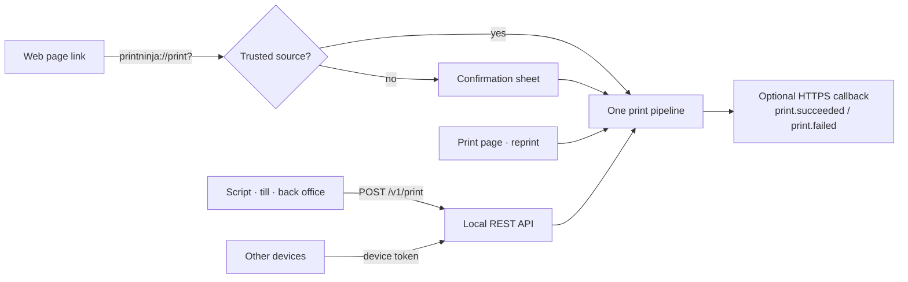

# ⚡ Templates and automation

> **Who this is for:** people who want to design their own templates, or print from scripts, a till or a web page.
> **What you will know after reading:** how templates and placeholders work, how to print through the local REST API, and how to print from a link.

You do not need any of this to print. It is here for when you want more control.

## 🎨 Design a template

A **document template** is HTML with `{{placeholders}}` where your data goes, plus a paper size. (Label templates for thermal printers are drawn on a canvas instead — see [Labels](./FEATURES.md#-labels).) This complete example prints a small parcel tag on 80 mm roll paper:

```html
<body class="p-2 text-xs font-sans">
  <p class="uppercase tracking-widest text-slate-500">PrintNinja Post</p>
  <h1 class="text-lg font-bold">To: {{customer.name}}</h1>
  <p>{{customer.address}}, {{customer.city}} {{customer.zip}}</p>
  {{barcode "code128" order.tracking width=60 text=false}}
  <p class="font-mono">{{order.tracking}}</p>
</body>
```

With this data (JSON):

```json
{
  "customer": { "name": "John Doe", "address": "45 Oak Lane, Apt 2", "city": "Gulshan", "zip": "1212" },
  "order": { "tracking": "PN-7X9K-4242-BD" }
}
```

Three things to know:

- **`{{dotted.paths}}` print text.** Nested keys walk the data (`{{customer.name}}`), and `{{#each order.items}}...{{/each}}` repeats a block once per list entry. Helpers such as `currency`, `date`, `upper`, `lower`, `number` and `padLeft` are available.
- **`{{barcode}}` draws the barcode.** `{{barcode "code128" order.tracking}}` makes an inline image from the data, so no image files are needed. QR codes work the same way with `"qrcode"`.
- **The page size is the paper.** Set 80 mm wide in Page Setup for roll paper (or 102 × 152 mm for a 4×6 label); the preview shows exactly that. Tailwind classes such as `p-2` and `font-bold` work and are built into the printout. Anything the network cannot reach at print time (remote images, web fonts) will not load, so embed them as `data:` links instead.

Every new document template starts from a ready-made example (Receipt, Delivery Slip, Invoice, Shipping Label, Kitchen Ticket or Blank), so you always have something concrete to edit. Label templates start as a blank label you arrange on the canvas.

## 🤖 Automate printing

PrintNinja runs a local REST API, so any script, till or back-office system on the same PC can print through it. The default address is `127.0.0.1:17717`; change the port in **Automation → API server**.

```bash
curl -X POST http://127.0.0.1:17717/v1/print \
  -H "Content-Type: application/json" \
  -H "Idempotency-Key: order-1042" \
  -d '{
        "template": "Receipt",
        "printer": "Front Desk",
        "data": { "order": { "id": "1042", "total": 18.5 } },
        "settings": { "copies": 2 }
      }'
```

- **No API keys.** Calls from the PC itself work as they are. Other devices on the network must be paired with the PC and present their own device token.
- **Safe retries.** Sending the same `Idempotency-Key` again never prints a second copy.
- **Honest answers.** The response reports the real outcome (printed, or why not). `GET /v1/jobs/{id}` tracks any job, and jobs can be retried or cancelled.
- **Document and label jobs stay separate.** You may send `"format": "html"` or `"format": "scene"`; leave it out and the template's own kind is used. A request that does not match the template is refused with a `track_mismatch` error instead of a broken printout. For a label job, `data` may be a list of records and each record prints as its own label.
- **Callbacks.** Add `"callback_url": "https://..."` to a print request and the app posts the result (`print.succeeded` or `print.failed`) to it when the job finishes, retrying a few times on failure. Only `https` addresses are accepted (private hosts only if you opt in). With a shared secret set, the message is signed with an `X-PrintNinja-Signature` header. See [`ENV.md`](./ENV.md) for the `PRINTNINJA_CALLBACK_*` settings.
- **Observable.** Health checks, metrics (JSON and Prometheus) and a live OpenAPI document at `/v1/openapi.json`.
- **Try it in the app.** **Automation → Try the API** lets you send test requests (desktop app only).

### How the entry points fit



All four ways in print through the same pipeline, so an idempotency key, a
safe retry and an honest result work the same everywhere.

## 🔗 Deep links

Deep links print from a link or a button on a web page:

```
printninja://print?template=My+Receipt&printer=Desk&copies=2
```

Other options include `url` (a data link), `data` (records for a label job), `format` (`html` or `scene`), `test=1`, `orientation`, `fit` and `preset`. Links from sources you have not trusted ask for confirmation first. Manage trusted sources in **Automation → Deep links**.

## 📚 Go deeper

- [Architecture](./ARCHITECTURE.md): how a print travels from data to paper
- [Queue and history](./architecture/QUEUE_AND_HISTORY.md): the queue, timings, metrics and callbacks
- [Glossary](./GLOSSARY.md): plain meanings for the terms used here

[⬅️ Back to the README](../README.md)
