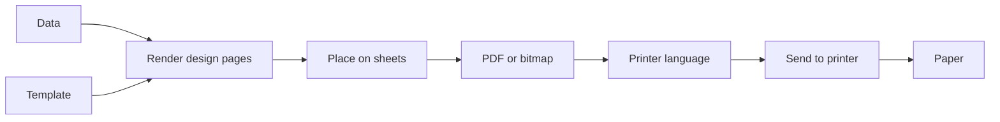

# PrintNinja: Investigation Report

**Repository:** https://github.com/SAR-dev/PrintNinja
**Branch / version investigated:** `develop`, v2.4.0 (commit `a007e17`)
**Scope:** documentation (README, architecture), mobile UI, and feature opportunities
**Status:** **Final.** Investigation only; no files in the repository were changed. Design decisions confirmed (see §2).

---

## 1. Summary

PrintNinja is a mature, well-tested product. The code quality and test discipline are high. The weaknesses are about *explaining* and *simplifying* it:

| Area | Verdict | One-line reason |
|---|---|---|
| Code health | Strong | `tsc`, Biome lint and 922 unit tests all pass on a fresh clone. |
| README | Accurate but overloaded | One file serves end users, integrators and contributors; no screenshots; stale version badge. |
| Architecture doc | Accurate but hard to enter | About 5,850 words, one ASCII diagram, no glossary, contradicts its own "no code" promise. |
| Mobile UI | Good foundations, poor flow | Tap targets and safe areas are right; the Print page is 2.7 screens of 15 fields and many layouts are horizontal. |
| Features | Clear gaps | Several are already admitted as "not implemented yet" in the docs. |

**Decisions recorded from review:** the phone UI is **vertical-only**, the app is **locked to portrait** on phones, the **bottom navigation bar stays**, and the phone **Designer is view and sample-data only** (editing happens on a computer). See [§2](#2-decisions-confirmed).

---

## 2. Decisions confirmed

| # | Question | Decision | Consequence |
|---|---|---|---|
| D1 | Phone layout | **Vertical-only**: one column, no side-by-side fields, no horizontal tab strips, no sideways scrolling | See [§6](#6-mobile-design-rule-vertical-only) |
| D2 | Bottom navigation bar | **Keep** (Print, History, Templates, Printers, More) | The one deliberate horizontal element; it is the standard thumb-reachable phone pattern |
| D3 | Landscape phones | **Lock the app to portrait** | Needs an Android manifest patch in the build and removal of landscape-phone code; see [§6.5](#65-portrait-lock-implementation-and-accessibility-note) |
| D4 | Designer on phones | **View and sample data only; edit on desktop** | Phone Designer becomes a viewer; see [§7.5](#75-designer-on-phones-viewer-mode) |
| D5 | README language | **English now**; Japanese README as a later follow-up | The app itself already ships English and Japanese |
| D6 | Screenshots | Generate from the **web preview with the fake agent**, then replace with real-device captures when available | Reproducible and scriptable; see [§5.4](#54-proposed-documentation-structure) |

D5 and D6 are sensible defaults rather than answers you gave directly. Change them if you disagree.

---

## 3. How this investigation was done

- Cloned the repo, checked out `develop`, installed dependencies with pnpm 10 on Node 22.
- Read `README.md`, `docs/*.md`, `TODO.md`, `CONTRIBUTING.md`, `src/mobile.css`, and the relevant parts of `Print.tsx`, `Layout.tsx` and the navigation list.
- Ran the web preview (`pnpm dev`) in headless Chromium at **390×844** with an Android user agent.
- Injected the project's own e2e **fake desktop agent** and seeded a paired PC, three templates and two printers, so real screens could be seen with data.
- Measured horizontal overflow and tap-target sizes on every main route.
- Ran the baseline checks: `tsc -b`, `pnpm lint`, `pnpm test`.

**Limits of this review**
- The phone UI was seen in a desktop browser with a fake backend, **not** on a real Android device.
- No real printer was used, and the Rust and Kotlin layers were read but not built.
- The red "Failed to load…" toasts in screenshots come from the missing backend in browser mode and are not counted as bugs, except where noted.

---

## 4. Project at a glance

| Layer | Tech | Size |
|---|---|---|
| Desktop and mobile shell | Tauri 2 (Windows MSI, Linux deb/AppImage, Android arm64) | |
| Core | Rust 1.90: print queue, transports, rendering, local REST API, SQLite | ~27,400 lines, ~307 tests |
| Android printing | Kotlin Tauri plugin (WebView to PDF, USB, Bluetooth) | ~2,500 lines |
| UI | React 18, TypeScript, Vite, Tailwind, shadcn/Radix, Zustand, TanStack | ~9,000 lines in pages, ~10,500 in components |
| Share service | Fastify 5, Prisma 7, Turso/libSQL (accounts, template sync) | ~7,700 lines |
| Tests | Vitest (72 files, 922 tests), Rust tests, Playwright (23 specs, desktop and phone projects, axe) | |

**Core idea of the pipeline:**



Every entry point (Print page, REST API, deep link, reprint) goes through this one pipeline. A phone never renders itself. It hands the render step to a paired PC on the same Wi-Fi.

**Largest files (refactor candidates):** `Designer.tsx` 1,732 lines, `Print.tsx` 1,562, `DevicesCard.tsx` 1,439, `History.tsx` 1,336, `Templates.tsx` 1,231, `Settings.tsx` 1,198.

---

## 5. Documentation findings

### 5.1 README (`README.md`, about 20 KB)

| # | Finding | Impact |
|---|---|---|
| R1 | Version badge says **2.2.0**; the project is **2.4.0**. The release doc asks for a manual bump. | Looks unmaintained. |
| R2 | **No screenshots or demo.** The only image is the logo. | A visual product is explained only in words. |
| R3 | One file mixes three audiences: end users, API integrators, contributors. | Everyone scrolls past content meant for others. |
| R4 | Jargon is unexplained: "shared rendering", "Print via PC", "IPP", "ESC/POS", "raw TCP 9100", "CUPS". No glossary. | New users cannot self-serve. |
| R5 | The "Features" section is a long flat list of about 45 bullets. | Value is buried. |
| R6 | "Phone-friendly layouts" is stated, but there is no phone walkthrough with visuals. | The flagship phone feature is the hardest to understand. |

What is already good and should be kept: the "Why PrintNinja" 3-step pitch, the worked parcel-tag template example, the `curl` example, the badge table, and the troubleshooting section written as symptom then fix.

### 5.2 Architecture doc (`docs/ARCHITECTURE.md`, 618 lines, about 5,850 words)

| # | Finding | Impact |
|---|---|---|
| A1 | Opens with "contains no code and no file references" but has about **74 inline identifiers**, source paths (`render/layout.rs`), env vars and HTTP routes. | Breaks reader trust; mixes two levels of detail. |
| A2 | Only **one ASCII diagram** for a system with a 9-stage pipeline and a phone to PC protocol. | Hard to hold the model in your head. |
| A3 | **§9 "Borrowing a faster device" is about 40% of the file.** It covers pairing, auth, guests and Print via PC. | It is really a separate security and sharing document. |
| A4 | Contains **changelog and decision-log text** ("since v1.1.0", "Decided, kept here so the plan file could go"). | Mixes timeless explanation with history. |
| A5 | Placement math (fit modes, pagination) comes before the backend pipeline in reading order. | Detail before overview. |
| A6 | No "start here by role" guidance and no glossary. | A designer, a backend dev and a support person need different parts. |
| A7 | Server code comments cite a non-existent `REFACTORING.md` (`server/src/boot.ts`, `server.ts`, `http/mappers.ts`, and others). | Dangling references. |

Positive: the writing is clear sentence by sentence; the "why" behind rules (never re-layout a design, phones ask PCs and never the reverse) is excellent and worth preserving.

### 5.3 Repository hygiene

- `TODO.md` at the repo root contains four items, **all already marked "implemented"**.
- Remote branches `guest-pairing-ux` and `pair-guest-automation-ux` are fully merged into `develop` (0 commits ahead).
- All internal Markdown links in README and docs resolve. No dead links were found.

### 5.4 Proposed documentation structure

```
README.md                      end users: what, screenshots, install, first print, phone, automate, troubleshoot
docs/
  GETTING_STARTED.md           (optional) the five-minute first print with screenshots
  GLOSSARY.md                  plain-language terms: IPP, ESC/POS, CUPS, design page, sheet, pairing, ...
  ARCHITECTURE.md              ~1,200 words: system map, pipeline, phone and PC diagram, "read next" by role
  architecture/
    rendering-and-layout.md    design size vs paper size, fit modes, pagination
    printers-and-transports.md network, system, USB, Bluetooth; printer languages; per-OS notes
    queue-and-history.md       queue, retention, timings, metrics, logs
    phone-and-pc-sharing.md    pairing, tokens, guests, Print via PC, failure behavior, security
  DECISIONS.md                 the "Decided / Decisions behind this section" content, dated
  DEVELOPMENT.md               quick start, layout, commands, tech stack (moved out of README)
  (existing) UI_GUIDE.md, ENV.md, CI.md, RELEASE.md, SIGNING.md
```

**Documentation rules to adopt**
1. Every doc starts with "Who this is for" and "What you will know after reading".
2. Overview docs contain no code identifiers. Deep dives may.
3. Every system has a diagram (Mermaid renders on GitHub).
4. Use plain words first and the technical term second, e.g. "the PC that renders for your phone (shared rendering)".
5. No version history inside explanatory text; history goes in `CHANGELOG.md` or `DECISIONS.md`.
6. The README version badge is updated by the release script (`scripts/`), not by hand.

**Diagrams to add**
- System map: Phone, PC, printers, share service.
- The pipeline (above), with the one stage that can run elsewhere highlighted.
- Phone and PC sequence: pair, render request, return bytes, print, history.
- "Where does my print fail?" decision tree for troubleshooting.

**Screenshots to add to README (taken in the real app):** Designer with live canvas, Print page, History with a failure message, phone pairing, phone Print.

---

## 6. Mobile design rule: vertical-only

**Rule:** on phones, every screen is **one vertical column**. Nothing requires sideways scrolling, sideways swiping, or reading across.

This is the agreed constraint for all mobile work below.

### 6.1 What "vertical-only" means in practice

1. **One field per row.** No side-by-side inputs. Each input is full width.
2. **No horizontally scrolling strips.** Tab bars, chip rows and filter rows that scroll sideways are replaced.
3. **No horizontal pan.** Previews, the Designer canvas and the code editor fit the screen width. Only vertical scroll exists.
4. **Wide content reflows.** Tables are already card lists; any remaining multi-column grid collapses to one column.
5. **Stacked actions.** Page actions become full-width buttons stacked vertically, with the primary action first.
6. **Portrait only.** The app is locked to portrait on phones (decision D3), so there is no landscape layout to design or test. See §6.5.
7. **Enforced by a test** (see §6.4), so it cannot silently regress.

### 6.2 Replacements for horizontal patterns

| Today (horizontal) | Vertical replacement |
|---|---|
| Tab strip (Templates: Mine / Saved / Community) | A full-width **view picker** that opens a bottom sheet, or three stacked full-width choices. Current view shown as the page subtitle. |
| Printers filter tabs (All / Network / USB / Bluetooth), clipped and scrolls sideways | One full-width **"Show: All printers"** picker. |
| Automation tab row (API server / Try the API / PC / Deep links), wraps to two rows | A **vertical list of sections** that opens each one, like the existing Settings list. |
| Designer tab row (Canvas / Code / README / Sample data) plus Save in one row, clipped | A **section picker** at the top, with **Save as a sticky bottom bar**. |
| Search and Filters side by side (History) | Search on one row, **Filters** full-width below. |
| Data URL beside GET/POST selector | Method on its own row under the URL. |
| Copies beside Pages | Stacked, one per row. |
| Orientation beside Fit mode | Stacked, one per row. |
| Four margin fields across | Four stacked rows, or one "Margins" screen in the options sheet. |
| Pill action buttons that wrap | Full-width stacked buttons. |
| Sort dropdown beside a "Sort" label (truncates to "Recently…") | Label above, full-width select below. |

**Confirmed exception (D2):** the **bottom navigation bar** (Print, History, Templates, Printers, More) stays. It is the standard thumb-reachable phone pattern and is the only intentionally horizontal element. Its rule: at most five items, each with an icon and a word, with the extra destinations (Designer, Automation, Settings) behind **More**.

---

### 6.3 Where the current code is horizontal (audit)

| File | Line | Pattern |
|---|---|---|
| `src/pages/Print.tsx` | ~769 | `grid grid-cols-2` |
| `src/pages/Print.tsx` | ~1116 | `grid grid-cols-2` (Orientation / Fit mode) |
| `src/pages/Print.tsx` | ~1223 | `grid grid-cols-2` |
| `src/pages/Print.tsx` | ~1281 | `grid grid-cols-4` (margins) |
| `src/pages/PrinterSetup.tsx` | ~859, ~952 | `grid grid-cols-2` |
| `src/pages/PrinterSetup.tsx` | ~681 | tab list (filters) |
| `src/pages/Automation.tsx` | ~87 | tab list |
| `src/pages/Designer.tsx` | ~1283 | `overflow-x-auto` tab list |
| `src/pages/Settings.tsx` | ~504 | `flex-row … overflow-x-auto` tab list |
| `src/pages/History.tsx` | ~1213 | `grid grid-cols-2` (details) |
| `src/mobile.css` | tabs rules | `tabs-list` as a horizontal flex row with hidden scrollbar |

Line numbers are from `develop` at v2.4.0 and may shift.

### 6.4 How to enforce it

- Extend the existing phone e2e spec (`e2e/tests/mobile.mobile.e2e.ts`), which already checks for sideways scrolling and 44 px targets, with two new assertions per route:
  1. No element inside `main` has a computed `overflow-x` of `auto` or `scroll` with `scrollWidth > clientWidth`.
  2. No two visible form controls in the same form share the same vertical position (no side-by-side fields).
- Add a rule to `docs/UI_GUIDE.md` under "Responsive and touch": *"Phones are one column. Use `grid-cols-1` below `md`; never ship a tab strip or scroll-x row on a phone."*
- Prefer a small shared primitive (e.g. a `ResponsiveTabs` that renders tabs on desktop and a picker or section list on phones) so pages do not each reinvent it.

### 6.5 Portrait lock: implementation and accessibility note

**Why it is simple:** with portrait locked, the phone UI needs exactly one layout (390 px design width, tested down to 360 px).

**What to change**

1. **Android manifest.** The Android project is generated in CI (`tauri android init --ci`) and `src-tauri/gen/android/` is git-ignored, so the lock cannot be committed directly. Add a small patch step (a script in `scripts/`, called from both CI jobs and the local release script) that sets `android:screenOrientation="portrait"` on the main activity after `init`, and fails loudly if the attribute is missing afterwards.
2. **Limit the lock to phones.** Tablets and Chromebooks should rotate freely. Use `sensorPortrait` on small screens only (for example via a resource qualifier or a runtime check on screen width), so large screens are unaffected.
3. **Remove dead code.** `LANDSCAPE_QUERY` in `src/lib/hooks/useMediaQuery.ts` and the `shortLandscape` branches in `src/components/Layout.tsx` (sidebar rail, hidden search, bottom-bar condition) only serve landscape phones. Remove them, and delete the landscape cases from the phone e2e project and from `docs/UI_GUIDE.md`.
4. **Web preview.** A browser cannot be locked. Show a one-line "Rotate your phone" hint if a narrow window is wider than tall, or simply keep the single column.

**Accessibility note (needs an explicit decision to accept).** `README.md` states a WCAG 2.1 AA target. Success criterion **1.3.4 Orientation (AA)** says content should not be restricted to one orientation unless it is essential. Locking phones to portrait is a common product choice, but it is a documented exception to that criterion, and it affects people who mount a phone in a fixed landscape holder. Mitigations: keep tablets free to rotate; record the exception in `docs/UI_GUIDE.md` under "Accessibility"; and keep every screen usable with large text and browser zoom. If this exception is not acceptable, the fallback is to leave rotation enabled and render the same single column in landscape.

---

## 7. Mobile UI findings

### 7.1 What already works well (keep)

- No horizontal page overflow and **no tap targets under 44 px** on all seven main routes tested.
- Safe-area insets, bottom sheets with grab handles, press feedback, large page titles, rounded cards.
- The phone design layer is cleanly isolated in `src/mobile.css`, scoped to `max-width: 767px`, so desktop is untouched.
- Phone e2e project with axe accessibility checks and screenshot baselines.
- Sticky Print button, collapsible preview, guest pairing flow, and the `/print` to pairing redirect for unpaired phones.

### 7.2 Problems

| # | Severity | Problem | Evidence |
|---|---|---|---|
| M1 | High | **Print page is too long.** About 2.7 screens and 15 fields. Orientation, fit, paper size, page range, margins and grayscale are all inline. | Measured scroll height 1,934 px vs 706 px visible. |
| M2 | High | **Preview is last.** You choose a template without seeing it; the preview is below all options and collapsed to a small window. | `Print.tsx` preview card after options. |
| M3 | High | **Contradictory design intent in code.** One comment says advanced fields move out "so the first screen stays short"; the next says "no separate advanced section". The second won. | `Print.tsx` ~1092 and ~1114. |
| M4 | High | **Pairing screen is a jargon paragraph.** "The PC renders each page and either sends it back… or, with Print via PC on, prints it on its own printers." | Unpaired phone landing. |
| M5 | Medium | **Horizontal layouts** throughout (see §6.3). | Audit above. |
| M6 | Medium | **Naming inconsistent.** Nav says "Printers"; the page title is "Printer Setup". Android lands on "Automation", a developer term. | Screens. |
| M7 | Medium | **Clipped controls.** Sort shows "Recently…"; the Printers filter tabs cut off "Bluetooth (0)" with no scroll hint. | Screens. |
| M8 | Medium | **Phone Designer header** shows a raw ID fragment ("Private 33333333") instead of the template name; the sticky tab row overlaps the canvas toolbar when scrolling. | Designer screenshots. |
| M9 | Medium | **No guard against an obviously wrong combination**, e.g. an A4 invoice template on an 80 mm receipt printer. | Default selection in Print. |
| M10 | Low | **Sign-in subtitle says "Printing still works from this PC"** while shown on a phone. | Sign-in screen. |
| M11 | Low | **Raw JavaScript errors can reach the user** ("Cannot read properties of undefined (reading 'invoke')"), and an old History error toast remained visible on the Printers page. | Browser-mode screens; verify on device. |
| M12 | Medium | **The Designer is a desktop tool on a small screen.** Editing HTML/CSS on a phone is inherently awkward. Resolved by decision D4 (viewer mode, §7.5). | Designer on phone. |

### 7.3 Proposed Print page (vertical, task-first)

Goal: a first-time user prints in **three taps** after pairing, and a returning user in **one**.

```
┌─────────────────────────────┐
│ Print                        │
│ ● Connected: Front Desk PC   │  ← status chip (links to pairing)
│                              │
│ 1  Template                  │
│ ┌─────────────────────────┐ │
│ │ [thumb] Receipt 80mm  ▾ │ │  ← picker with thumbnail
│ └─────────────────────────┘ │
│                              │
│ 2  Printer                   │
│ ┌─────────────────────────┐ │
│ │ Epson TM-T20          ▾ │ │
│ └─────────────────────────┘ │
│ ⚠ Template is 210×297 mm;    │  ← mismatch warning (M9)
│   this printer uses 80 mm    │
│                              │
│ 3  Data                      │
│ ( ) Sample data              │
│ ( ) From a link              │
│   [ https://…            ]   │
│                              │
│ Copies   [ − ]  1  [ + ]     │
│                              │
│ ┌─────────────────────────┐ │
│ │ Preview (page 1 of 1)   │ │  ← inline, directly under inputs
│ └─────────────────────────┘ │
│                              │
│ ▸ Layout options             │  ← opens bottom sheet
│                              │
│ ┌─────────────────────────┐ │
│ │        🖨  Print        │ │  ← sticky
│ └─────────────────────────┘ │
└─────────────────────────────┘
```

**Layout options bottom sheet** (vertical list, one control per row): Paper size, Orientation, Fit mode, Margins (four stacked fields), Page range, Grayscale, and "Send test page". A line on the main page shows a summary when anything is non-default ("Fit to width · Portrait · 5 mm margins").

Other changes: remember the last template and printer; replace "Pages" with a plain-language label and one sentence of help; show a non-technical error with a single **Retry** or **Open History** action after a failed print.

### 7.4 Proposed pairing and first-run flow

Replace the paragraph with three numbered steps, one visible at a time:

1. "On your computer, open **PrintNinja → Phones** and turn on sharing."
2. "Type the 8-letter code shown there." (large single input, auto-capitalize, auto-advance)
3. "Connected to *Front Desk PC*." (success state; **Print** button)

Add a status line that always shows connection state ("Connected to Front Desk PC" / "PC not found, check Wi-Fi") with a **Try again** button.

### 7.5 Designer on phones: viewer mode

Decision D4: on phones the Designer is a **viewer**; creating and editing templates happens on a computer.

**What the phone offers (vertical sections, chosen from a section picker, no tab strip):**

| Section | Phone behavior |
|---|---|
| Preview | Full-width, fit-to-width, vertical scroll only, no pan |
| Sample data | **Editable** (this is the one thing a phone user may need to adjust), saved with a sticky bottom **Save** |
| README | Read-only |
| Code | Read-only, line-wrapped, no horizontal scroll |
| Details | Template **name** shown in the header (replacing the raw ID fragment), size, sync state, last saved |

**What the phone does not offer:** editing HTML or CSS, page setup, version restore, publishing. In their place, one clear notice: *"Templates are edited on a computer. Changes sync to this phone automatically."*

**Knock-on changes**
- **Templates page:** hide or disable **New template** and **Clone** on phones, showing the same notice instead of a dead button. Keep **Open** (view) and **Use** (jump to Print with this template).
- **Command palette:** remove "New template" on phones.
- **Print page:** add **Preview** access to the selected template, since viewing is now the phone's main relationship with templates.
- **Sync:** make it obvious that a template edited on the PC appears on the phone (show "Updated 2 min ago" on cards). If a phone's copy is stale, offer **Sync** (the existing Print via PC behavior).
- **Code reduction:** the phone no longer needs the code editor's touch handling or the canvas editing controls, which simplifies `Designer.tsx` on phones.
- **Tests:** update the phone Designer e2e flow to assert read-only behavior and that editing controls are absent.

Open follow-up for later: an optional **"Send me the link"** action so someone can open the template on a computer quickly.

---

### 7.6 Other mobile changes

- **Naming:** on phones, "Automation" is shown as **"Connect to PC"** (or "PC & sharing"); "Printer Setup" becomes **"Printers"**; "Print via PC" gets a plain sentence ("Print on the PC's printers instead of this phone's").
- **Designer on phone:** viewer mode per §7.5 (name in header, section picker, read-only code, editable sample data, sticky Save only for sample data).
- **History:** stacked search and filters; each job card shows status (icon, color, word), template, printer and time, with **Reprint** as the primary action.
- **Errors:** map low-level errors to human sentences at the IPC layer; clear toasts on route change.
- **Copy:** fix the sign-in subtitle on phones.

### 7.7 Constraints to plan for

- Phone e2e screenshot baselines (`e2e/tests/mobile.mobile.e2e.ts-snapshots`) must be refreshed once after the redesign.
- Every new string needs both `en.ts` and `ja.ts` entries (a test fails otherwise).
- Colors must stay on existing tokens to keep the contrast assertions in `src/test/tokens.test.ts` passing.
- Keep desktop unchanged by scoping all changes to the phone query.
- With portrait locked, remove the landscape-phone code paths (§6.5) rather than leaving them untested.
- Extract the new pieces from `Print.tsx` and `Designer.tsx` into components as part of the change rather than growing those files.

---

## 8. Feature opportunities

| # | Feature | Why now | Effort | Value |
|---|---|---|---|---|
| F1 | **QR-code pairing**: scan the PC's screen instead of typing 8 characters | Pairing is the main phone friction; fits a vertical, three-step flow | Small–Medium | Very high |
| F2 | **Starter template pack**: receipt, 4×6 shipping label, invoice, parcel tag, price tag | Empty "No templates yet" is the first thing a new user sees | Small | High |
| F3 | **Smart printer and template matching**: paper-size mismatch warning, per-printer default template and paper | Prevents wasted paper; no new concepts for users | Small | High |
| F4 | **Automatic discovery of network printers and PCs** (mDNS / DNS-SD) | The docs say discovery is "not implemented yet" on every platform | Medium | High |
| F5 | **Direct thermal printing from Android** (ESC/POS, ZPL, TSPL, CPCL) | Android is PDF-only today and always needs a PC | Large | Very high |
| F6 | **Webhook / callback on completion** | The API currently rejects `callback_url` with a 400; POS systems want "printed" events | Medium | High for integrators |
| F7 | **Android share target and camera scan**: share a PDF or photo to print; scan a barcode to fill a field | Makes the phone a real input device, not just a remote | Medium | High |
| F8 | **Printer alerts and routing rules**: low-paper or offline notification, template to printer defaults, failover printer | Builds on existing status checks | Medium | Medium–High |
| F9 | **CSV column-mapping UI** for bulk prints | Today users shape JSON by hand | Medium | Medium |
| F10 | **Encrypted LAN traffic** (pinned certificate) | Listed as planned in the architecture doc; traffic is plain HTTP today | Medium | Medium (security) |
| F11 | **Visual or block template builder**, optional AI-assisted template from a photo or sample | Lowers the HTML/CSS barrier for non-developers | Large | High |
| F12 | **Dark mode and more languages** (currently one light theme; English and Japanese) | Useful in warehouses and outdoors; broader reach | Medium | Medium |
| F13 | **Per-template guest permissions and roles** | Explicitly excluded in the current design; revisit if teams grow | Medium | Situational |

**Suggested order:** F2 and F3 (quick wins), then F1 (alongside the mobile redesign), then F4, then F5 as the headline project. F6 and F7 can run in parallel as integration work.

---

## 9. Recommended roadmap

**Phase 1: Clean up and document (about 1 week)**
- Delete `TODO.md` and the two merged branches; fix `REFACTORING.md` references.
- Restructure README; add screenshots and glossary; automate the version badge.
- Split `ARCHITECTURE.md` per §5.4 with diagrams; move decisions to `DECISIONS.md`.

**Phase 2: Mobile redesign (about 2 weeks)**
- Add the vertical-only rule to `UI_GUIDE.md` and the e2e assertions (§6.4).
- Add the portrait lock: manifest patch step in CI and local scripts, tablet exception, removal of `LANDSCAPE_QUERY` code (§6.5), and a note in `UI_GUIDE.md` about the WCAG 1.3.4 exception.
- Build the shared `ResponsiveTabs` primitive; convert Templates, Printers, Automation, Designer and Settings.
- Make the phone Designer a viewer with editable sample data (§7.5) and adjust Templates actions accordingly.
- Rebuild the Print page (§7.3) and the pairing flow (§7.4).
- Fix naming, errors and copy (§7.6).
- Refresh phone snapshots; run `pnpm check:full`.

**Phase 3: Quick-win features (about 1 week)**
- F2 starter templates, F3 mismatch warnings, F1 QR pairing.

**Phase 4: Larger features**
- F4 discovery, F5 Android thermal printing, F6 webhooks.

Each change should go to `develop` in small conventional-commit PRs with a regression test, as `CONTRIBUTING.md` requires.

---

## 10. Remaining risks and notes

1. **WCAG 1.3.4 (Orientation):** the portrait lock is a documented exception to the project's WCAG 2.1 AA target. Accept it explicitly or fall back to a rotatable single column (§6.5).
2. **Phone template authoring is removed.** Users who currently build a quick template on a phone lose that ability. If analytics or support history show this is used, revisit with a minimal "edit text only" mode later.
3. **Generated Android project.** Because `gen/android` is not committed, the orientation patch must run on every `tauri android init`, and CI should verify it.
4. **Browser-preview limits.** Screens in this report were reviewed with a fake backend in a desktop browser. A pass on at least one real Android phone is needed before sign-off on the redesign.
5. **Defaults awaiting confirmation:** English-only README for now (D5) and screenshots generated from the web preview (D6).
6. **Snapshot churn:** one deliberate refresh of the phone e2e baselines after the redesign; avoid refreshing them on unrelated PRs.

---

## 11. Baseline results

| Check | Result |
|---|---|
| `pnpm exec tsc -b` | Pass |
| `pnpm lint` (Biome, 356 files) | Pass, no fixes needed |
| `pnpm test` (Vitest) | 72 files, **922 tests passed** |
| Phone overflow check (7 routes at 390 px) | 0 px horizontal overflow on all |
| Phone tap-target check (7 routes) | No targets under 44 px |
| Internal doc links | All resolve |
