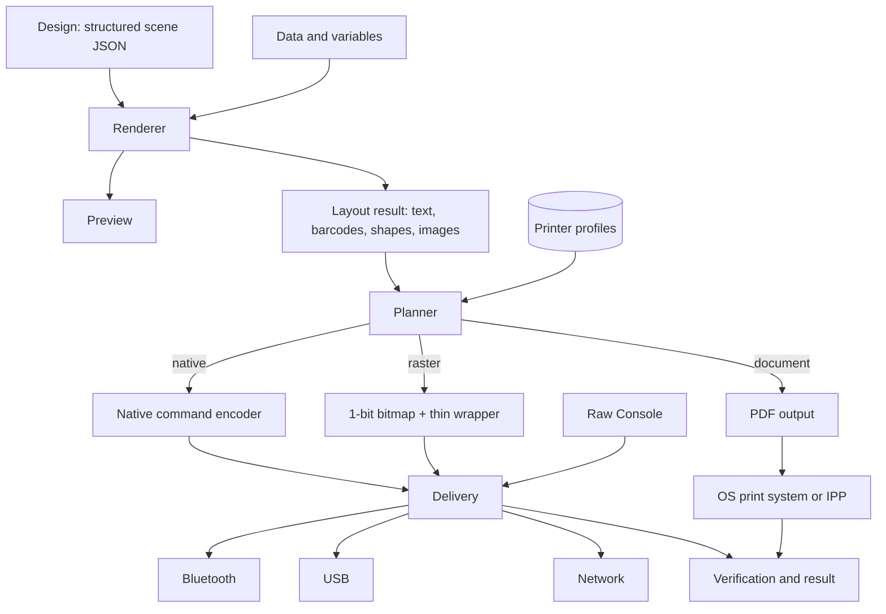

# Reliable Printing App: architecture plan

**Status:** approved for a complete rewrite. Nothing here has been built, benchmarked or tested on hardware. Statements about specific printers (for example the Toshiba B-FP2D) are hypotheses to confirm with the Raw Console described below.

**Rewrite decisions (2026-11-20):**

- **Greenfield, new repo.** The current PrintNinja stays as-is and keeps shipping; the rewrite lives in a new repository. Template migration happens at the end (phase 9).
- **v1 scope: core print flow + local settings.** No phone↔PC sharing, no REST API, no template publishing. Those can be rebuilt on top of the stable core later.
- **New UI, minimal first.** The React frontend and designer are rebuilt against the new core; a minimal working UI ships before the full designer.
- **Multi-page from day one.** The scene format supports multiple pages, variable-length content (receipt line items that flow and paginate) and batch printing (N labels, per-label data) from v1. Verification states include partial success.
- **No macOS, permanently.** The rewrite targets Windows, Linux and Android only; macOS is not a future target either. The current PrintNinja remains the macOS option until it is retired.

## 1. Goal and priority

Print labels, receipts and documents from phone and desktop, on many printer types, with similar capabilities to PrintNinja.

**Top priority: reliability.** A job either prints or tells the user clearly why it did not. "Sent" must never mean "the printer silently threw it away". Speed and flexibility come second.

## 2. What goes wrong today

| Problem | Effect |
| --- | --- |
| Rendering depends on a browser (headless Edge or Chromium, Android WebView) | Failures unrelated to the printer ("Edge produced no PDF"), slow start, different output per platform |
| Labels are sent as large bitmaps over raw Bluetooth | Chunking, buffer and timing problems; silent drops |
| Printer quirks are spread through the code (command mode, pacing, status queries) | Each new printer is a code change and a guess |
| No way to test bytes against a real printer from the app | Every experiment is a rebuild |

## 3. Design principles

1. **Printer facts live in data, not code.** One profile per printer model.
2. **Verify, don't assume.** Every send ends with evidence: a printer reply, a status check, or a clear "unknown" state.
3. **Smallest possible payload.** Native commands for simple labels; bitmaps only when needed.
4. **One renderer everywhere.** Preview and print use the same output.
5. **Test on real hardware early.** The diagnostic console ships before the new renderer.

## 4. Architecture overview



## 5. Components

### 5.1 Scene format (design)

A JSON description of a **template**: page geometry (fixed-size label, or continuous/roll media), then a list of elements (text, image, barcode, QR, line, rectangle) with position, size, style and data bindings such as `{{name}}`.

Multi-page and batch semantics are part of the format from v1:

- **Pages:** a template renders to one or more pages (or one continuous strip). Elements can be repeated per page (running header/footer) or placed on a specific page.
- **Repeating groups:** an element can be a group bound to a data array (for example receipt line items), rendered once per record and flowing/paginating across pages or labels.
- **Batch:** one template + a set of data records expands to N outputs (one label per record). The job, not the template, carries the count.
- Pagination is computed by the renderer at the printer's page geometry, so the same template paginates correctly per printer.

- Simple to validate, diff and store.
- The same file drives preview and print.
- HTML import can be added later as a converter, not as the core format.

### 5.2 Renderer

One in-process renderer, shared by all platforms, written in Rust (the project's existing language).

- Text layout with proper shaping and font fallback, including Japanese.
- Draws to a bitmap at the printer's dpi, or to PDF.
- Deterministic output: the same scene gives the same bytes on phone and desktop, which makes it testable.

### 5.3 Planner

Chooses the output path per job, using the printer profile:

| Path | When | Why |
| --- | --- | --- |
| **Native commands** | The scene only uses elements the printer's language can draw (text in a supported font, barcodes, lines, boxes) | Tens of bytes instead of an image, sharp output, fastest, most reliable over Bluetooth |
| **Raster** | Anything else (custom fonts, Japanese text, images, complex shapes) | Works for any layout on any thermal printer |
| **PDF through the OS** | The printer has a driver or IPP | No printer language needed at all |

If the preferred path is refused by a profile rule or fails verification, the planner falls back to the next one and records why.

### 5.4 Printer profiles

A data file per model (JSON or TOML), shipped with the app and extendable by the user:

```text
model, aliases
language and required printer mode (for example: "ZPL needs CMD SETTING = Z MODE")
dpi, head width in dots, supported media types
text capabilities (fonts, code pages)
barcode types supported natively
delivery: chunk size, pause, close delay, flow control
status support: query, expected reply, how to read errors
known quirks and a link to the evidence
```

The profile replaces scattered special cases. Adding a printer means adding a profile and running the test checklist, not changing the code.

### 5.5 Encoders

Small, separately tested modules, one per language: ESC/POS, ZPL, TSPL, CPCL, and later TPCL. Each takes an **expanded job** — the scene expanded against its data records into a list of pages/labels — and exposes two functions:

- `native(job, profile) -> bytes`, or "unsupported". For a batch, one label's command block per record (e.g. repeated `^XA…^XZ` in ZPL, the print-count parameter in TSPL/CPCL).
- `raster(job, profile) -> bytes`, the thin image wrapper, one bitmap per page/label.

Golden-file tests pin the exact bytes for each case.

### 5.6 Delivery

Transports: Bluetooth (RFCOMM), USB, TCP, and the OS print system. Reliability rules:

- Paced writes, with the pace taken from the profile.
- Hold the connection open until the printer has finished, with a close delay from the profile, instead of a hard-coded value.
- Read replies on the same connection where the printer supports it.
- Retry only when the failure happened before any byte was accepted, to avoid printing duplicates.
- One job at a time per printer, queued, so jobs cannot interleave.

### 5.7 Verification and result

Every job ends in one of these states, shown to the user in plain words. For multi-label or multi-page jobs the state always carries a count ("41 of 50"), because a batch can partially print:

| State | Meaning |
| --- | --- |
| Printed (confirmed) | The printer's own status or reply confirms completion |
| Sent (unconfirmed) | Bytes were accepted but this printer cannot confirm. The UI says so honestly. |
| Partially printed (N of M, with reason) | A batch or long job stopped mid-way (for example paper out on label 42). The user can restart the remainder or the whole job. |
| Failed (with reason) | For example connection lost, printer paused, wrong mode detected |
| Wrong mode suspected | Data was accepted but the profile says the printer ignores this language in its current mode |

Printer-side checks (paper out, cover open, paused) use the profile's status query, run only when the profile says the printer answers it, and never block a print on silence.

### 5.8 Raw Console (diagnostics)

A developer-toggled screen to send raw bytes with adjustable pacing, close delay and reply capture, with a history of the last sends and a copyable report. It is the tool used to create and verify printer profiles. See `RAW-CONSOLE-PLAN.md` for the detailed design.

### 5.9 Scene schema (v1 detail)

The scene is a **template**: it describes one output. A **job** is `template + records[]` — for label media, one record expands to one label (a batch is N records); for document/continuous media, one record expands to one (possibly multi-page) output.

```jsonc
{
  "version": 1,
  "name": "Cafe receipt",
  "media": { "kind": "continuous", "width": "80mm" },
  "margins": { "left": "2mm", "right": "2mm" },
  "elements": [
    { "id": "shop", "kind": "text", "x": "2mm", "w": "76mm",
      "text": "{{shop_name}}",
      "font": { "family": "default", "size": "12pt", "weight": "bold" },
      "align": "center" },
    { "id": "rule", "kind": "line", "x1": "2mm", "x2": "78mm", "thickness": "0.5pt" },
    { "id": "items", "kind": "group",
      "repeat": { "over": "items", "as": "item" },
      "elements": [
        { "id": "name",  "kind": "text", "x": "2mm",  "w": "52mm", "text": "{{item.name}}" },
        { "id": "total", "kind": "text", "x": "54mm", "w": "24mm", "text": "{{item.qty}} × {{item.price}}", "align": "right" }
      ] },
    { "id": "grand", "kind": "text", "x": "54mm", "w": "24mm",
      "text": "Total: {{total}}",
      "font": { "size": "12pt", "weight": "bold" }, "align": "right",
      "keepTogether": true }
  ]
}
```

Element kinds: `text`, `image` (`src` is an asset id or embedded data URI, `fit`: cover/contain/fill), `barcode` (`type`, `value`, `height`, `showText`), `qr` (`value`), `line` (`x1, y1, x2, y2, thickness`), `rect` (`x, y, w, h, fill, stroke, radius`), `group` (repeating, above).

Layout rules per media kind:

| Media `kind` | Geometry | Layout |
| --- | --- | --- |
| `label` | fixed `width` + `height` (or printer profile default) | All coordinates absolute inside the label; a repeating group inside a label must declare a fixed `rowHeight` |
| `continuous` | fixed `width`, height derived from content | Elements flow vertically in document order; `x`/`w` are horizontal; height is the sum of element heights (receipts grow with line items) |
| `page` | named page (`a4`, `letter`, …) | Content flows and paginates; `header`/`footer` element lists repeat on every page; `keepTogether: true` on an element or group forbids splitting it across pages; overflow beyond the last page is a validation error unless `overflow: clip` |

Data bindings: `{{field}}` on the record, `{{item.name}}` inside a group (bound by `repeat.as`), plus engine variables `{{page}}`, `{{totalPages}}`, `{{index}}`, `{{count}}` (the latter two in batch context). Records come from JSON or CSV; a missing field renders as empty and is reported in the preview, never silently in the print.

Pagination is computed by the renderer at the printer's geometry and DPI, so one template paginates correctly per printer (§5.1). Expansion (template + records → list of pages) is a pure, deterministic function of the two — unit-tested with golden output.

### 5.10 Profile schema (TOML)

One file per model under `core/profiles/`, versioned in-repo; user extensions live in the app's data directory and override shipped values field-by-field.

```toml
[profile]
model = "GK420d"
aliases = ["zebra gk420", "gk420d"]
status = "untested"            # verified | community | untested
language = "zpl"               # zpl | escpos | tspl | cpcl
mode = "zpl"                   # required mode on dual-mode printers
dpi = 203
head_width_dots = 864
media = ["label"]              # label | continuous | page
min_gap_dots = 8

[fonts]
native = ["0", "1", "2", "3", "4"]
code_pages = ["437", "850", "1252"]
unicode_native = false         # native fonts cover Unicode (decides native vs raster fallback)

[barcodes]
native = ["CODE128", "EAN13", "QR", "PDF417"]

[delivery]
chunk_bytes = 1024
pause_ms = 10
close_delay_ms = 500
flow_control = "pace"          # pace | xon-xoff | none
keep_open_for_status = true

[status]
query = "^U"                   # raw bytes, escaped; language-specific (DLE EOT for ESC/POS, …)
expected_prefix = "STATUS"
poll_after_ms = 200
reports_paper = true
reports_cover = false
reports_paused = true

[[quirks]]
id = "needs-finalize"
note = "Last line must be followed by ^PKS or a 200ms delay, or the label is dropped"
evidence = "raw-console/2026-11-18-gk420d.txt"   # link to the Raw Console session that proved it
```

Rules: every field is optional with a sane default; a profile is invalid if `status.query` is set but `expected_prefix` is not, or if `head_width_dots` disagrees with `dpi` × printable width by more than one dot. Every quirk must carry evidence — a quirk without a captured Raw Console session is a bug in the profile, not a feature.

### 5.11 Workspace and crate layout

```text
repo/
├── core/
│   ├── scene/        # §5.1/§5.9: schema, validation, bindings, expansion + pagination (pure, no I/O)
│   ├── render/       # §5.2: text shaping, barcodes/QR, 1-bit bitmap and PDF output; snapshot tests
│   ├── planner/      # §5.3: path selection (native | raster | os-print), fallback + recorded reason
│   ├── profiles/     # §5.4/§5.10: TOML schema, loader, validation, registry + user overrides
│   ├── encoders/     # §5.5: one module per language (escpos, zpl, tspl, cpcl); golden-byte tests
│   ├── transport/    # §5.6: bt, usb, tcp, os-print adapters; pacing, queue, reply reading
│   └── job/          # job model: state machine, result states (§5.7), retry policy, partial counts
├── app/              # Tauri shell (Windows, Linux): settings, template storage (SQLite), Raw Console, UI
│   └── ui/           # React + TypeScript: scene designer v1, data input, print dialog, results
└── tests/
    ├── golden/       # golden byte files: encoder × profile × case
    └── e2e/          # virtual printers (IPP + raw) driving full jobs: success, unconfirmed, failure, partial
```

Dependency rules (enforced by the workspace):

- `scene` depends on nothing in this workspace — it is the shared vocabulary.
- `render` takes an expanded page plus a target geometry/DPI; it does not read profiles.
- `planner` reads profiles + the expanded job and decides the path; it never emits bytes.
- `encoders` read profiles + scene types only; only `raster()` touches pixels.
- `transport` is language-blind — it moves bytes, applies pacing and reports byte-level facts.
- `job` is the only crate that orchestrates the others and owns the result states.
- `app` depends on `job` + `transport` + `profiles`; the UI talks to the app crate, never to core directly.

## 6. Platform layout

| Platform | Renderer | Transports |
| --- | --- | --- |
| Android | Shared Rust renderer | Bluetooth, USB, network, Android print service where a driver exists |
| Windows | Shared Rust renderer | Bluetooth, USB, network, Windows print spooler |
| Linux | Shared Rust renderer | Bluetooth, USB, network, CUPS |

All platforms share the scene, renderer, planner, profiles and encoders. Only the transport adapters differ.

macOS is out of scope for the rewrite, permanently (decided 2026-11-20) — not a deferred feature. The current PrintNinja remains the macOS option until it is retired.

## 7. Testing strategy

- **Golden-byte tests** for each encoder and each profile path.
- **Renderer snapshot tests:** the same scene produces the same bitmap on every platform.
- **Virtual printers** (reuse the existing ones) for end-to-end tests of delivery, pacing and failure handling.
- **Hardware checklist per profile:** a short script of jobs (minimal text, label, barcode, long job, two jobs back to back) with the expected result, run on the real printer before a profile is marked verified.
- **Profile status field:** `verified` (hardware-tested), `community` or `untested`, shown to users.

## 8. Phase-by-phase plan (greenfield rewrite)

Each phase ends in something testable; no phase is "done" until its exit criteria hold. Phases are sequential in the main line; within a phase, the work items can interleave.

### Phase 0 — New repo and skeleton

- New repository, Rust workspace: `core/{scene,render,planner,profiles,encoders,transport,job}` crates plus an `app` crate (Tauri, Windows and Linux first).
- CI from day one: `cargo fmt --check`, `cargo clippy --all-targets -- -D warnings`, unit tests in a Docker test container (capped build jobs/memory, `target/` in a named volume, JUnit report) — carry the harness over from the current repo.
- Golden-file test harness for encoders, and port the current repo's virtual printers (IPP + raw) into the test harness for later e2e use.

**Exit:** empty workspace builds green in CI on Windows and Linux; golden-file harness and virtual printers run in CI with placeholder cases.

### Phase 1 — Raw Console

- Minimal Tauri app shell containing the Raw Console (§5.8): send raw bytes over Bluetooth/USB/TCP with adjustable pacing and close delay, reply capture, send history, copyable report.
- This is the **first shippable build** and the tool used to create every printer profile.

**Exit:** arbitrary bytes can be sent to and captured from real printers on Windows and Linux.
*Note: the first target is the printer already on hand — model to be confirmed before phase 1 starts (the "B-FP2D" mentioned elsewhere is a barcode scanner, not a printer; see §9).*

### Phase 2 — Printer profiles

- Profile format (§5.4) as TOML: schema, loader, validation, profile status (`verified` / `community` / `untested`).
- Mine the current codebase and extract every per-printer special case (mode requirements, chunk size, pacing, status queries, quirks) into profile data.
- Hardware checklist script per profile (minimal text, label, barcode, long job, two jobs back to back), driven by the profile.

**Exit:** every printer the current app ships exists as a profile; no per-printer code paths remain in core; at least one profile marked `verified` on real hardware.

### Phase 3 — Delivery and job verification

- Transport adapters: Bluetooth (RFCOMM), USB, TCP, and the OS print system (Windows spooler, CUPS), with profile-driven pacing, close delay and reply reading; one job at a time per printer, queued.
- Job result model (§5.7) including **partial success** with counts for multi-label/multi-page jobs.
- Retry policy, stated honestly: retry only failures that happened before any byte was flushed (connection refused, no data sent). A failure mid-transfer is a hard `failed`/`partially printed` result — no blind retry; the user restarts the job explicitly.
- E2E tests against the virtual printers: success, unconfirmed, failed, and paper-out mid-batch.

**Exit:** e2e suite green — every job ends in an honest state, and a mid-batch failure reports "N of M printed" with the reason.

### Phase 4 — Scene format and data model

- Scene schema v1 (§5.1): pages (fixed-size or continuous), elements, repeating groups over data arrays, `{{binding}}`s, pagination rules; deterministic serialization; Rust (serde) and TypeScript schema mirrors so preview and editor agree.
- Data model: records (CSV/JSON) → job expansion. One record → one label (batch = N records); one record → an N-page document; receipt line items flow and paginate.
- Unit tests for expansion and pagination with golden output.

**Exit:** one schema fully describes a single-page label, an N-page document, a variable-length receipt, and a batch of N labels with per-label data — and expansion is deterministic and tested.

### Phase 5 — Raster renderer and first real prints

- In-process Rust renderer (§5.2): text shaping with font fallback (including Japanese), barcode/QR generation, 1-bit bitmaps at the printer's DPI, and PDF output for the OS-print path (document media, non-thermal printers) — one renderer drives both; deterministic across platforms (renderer snapshot tests).
- `raster()` wrappers per language; the planner selects the raster path only in this phase.
- End-to-end: scene → render → raster bytes → delivery → verification.

**Exit:** real hardware prints a multi-page document and a batch of labels with per-label data, on Windows and Linux, producing identical bytes.

### Phase 6 — Native command path

- `native()` per encoder (§5.5): text in the printer's supported fonts, barcodes, lines, boxes; returns "unsupported" when the scene exceeds the printer's native capabilities.
- Planner selection across all three paths (native → raster → OS print, §5.3) with a recorded reason for each fallback; document media on driver-equipped printers defaults to the OS print path.
- Golden-byte tests per language and profile; verify the emitted bytes on real printers via the Raw Console.

**Exit:** simple labels print natively at a fraction of the raster byte count; complex scenes fall back to raster automatically; no design is blocked by the planner.

### Phase 7 — UI (minimal first)

- Screens: template list + scene-based template editor v1 (elements, positions, styles, data bindings, page and repeating-group settings), data input (CSV/JSON) with a preview of the expanded pages, print dialog (printer, copies, batch), job result display (all states including partial, with counts), settings (profile overrides, pacing, close delay).
- Persistence: templates and settings in local storage (SQLite).
- Preview is the renderer's own output — the same path as print (§3.4).

**Exit:** a non-developer goes template → data → print → sees a confirmed (or honestly unconfirmed) result, using no developer tooling.

### Phase 8 — Hardening and hardware verification

- Run the hardware checklist per profile; mark profiles `verified` as they pass.
- Failure drills: paper out mid-batch, cover open, cable/Bluetooth drop mid-job, wrong mode detected, printer paused.
- Performance checks: byte count and transfer time over Bluetooth for the native vs raster paths; start-to-result latency.
- Decide i18n and accessibility scope for v1.

**Exit:** §10 success criteria hold for every supported printer and platform; release candidate cut.

### Phase 9 — Android and template migration

- Android transport adapters (Bluetooth, USB, network, Android print service where a driver exists) and packaging; the renderer, planner, profiles and encoders are shared unchanged.
- HTML/Handlebars import converter for existing PrintNinja templates; during migration, pixel-diff imported templates' output against the old renderer's output.

**Exit:** existing templates import and print identically; Android prints a multi-page document and a batch of labels.

## 9. Risks and open questions

| Risk or question | Mitigation |
| --- | --- |
| Custom renderer means owning text shaping and font handling | Use an established Rust text and 2D stack instead of writing one; budget extra time for Japanese |
| Losing HTML and CSS freedom | Keep the HTML import path; define the supported element set early with real templates |
| Native mode cannot draw every design | The planner falls back to raster automatically, so no design is blocked |
| Printers differ more than profiles capture | Profiles are data, so they can be fixed without a release; the Raw Console shortens investigation |
| The "B-FP2D" target is a barcode scanner, not a printer | Resolved 2026-11-20: phase 1 starts on the printer already on hand; **model still to be confirmed before phase 1**, and the Raw Console resolves its mode and quirk behavior before any profile rule is encoded |
| Printers that never report status | Show "Sent (unconfirmed)" instead of claiming success |
| Which existing PrintNinja features must be kept (REST API, peer rendering, history)? | Decided 2026-11-20: v1 is the core print flow + local settings; sharing/REST/publishing come back on top of the stable core if needed |
| macOS is not in the platform table, but the current Tauri app runs there | Resolved 2026-11-20: macOS is out of scope permanently, not just for v1; no transport/packaging work is planned for it |

## 10. Success criteria

- A supported printer either prints or the user gets a specific reason within seconds.
- No silent "sent" results on printers that can confirm.
- Adding a new printer needs a profile and a checklist run, not a code change.
- The same template gives the same output on phone and desktop.
- A small Bluetooth label sends in a fraction of the bytes of the bitmap path.
